# Sequence-diagram gallery

[Back to dataset README](../../README.md) · [Conventions and coverage](../../4_gold_standard_sequence_diagrams/README.md)

Gold-standard sequence diagrams, rendered from the Mermaid sources in `4_gold_standard_sequence_diagrams/`. They are an addition to the original dataset, written for a master thesis on validating LLM-generated domain models, and are not part of the work of Bragilovski et al. Click an image to open its SVG and zoom in. Each diagram lists the user stories it covers, numbered by their line in the story file.

Projects: [Camperplus](#camperplus) · [Fish & Chips](#fish--chips) · [Grocery](#grocery) · [Planningpoker](#planningpoker) · [Recycling](#recycling) · [School](#school) · [Sports](#sports) · [Supermarket](#supermarket) · [Ticket](#ticket)

## Camperplus

8 diagrams, 71 messages, 51 of 55 user stories covered (not covered: 7, 9, 18, 20), 22 of 26 gold associations used. [User stories](../../1_user_stories/camperplus.txt) · [Domain model](../camperplus.svg)

### SD1 · Enroll a camper

A parent creates an account or is added by the camp administrator, enrolls a camper and follows the enrollment. The administrator stores emergency and guardian information.

[Mermaid source](../../4_gold_standard_sequence_diagrams/camperplus/sd1_enroll_camper.mmd) · [SVG image](camperplus/sd1_enroll_camper.svg)

[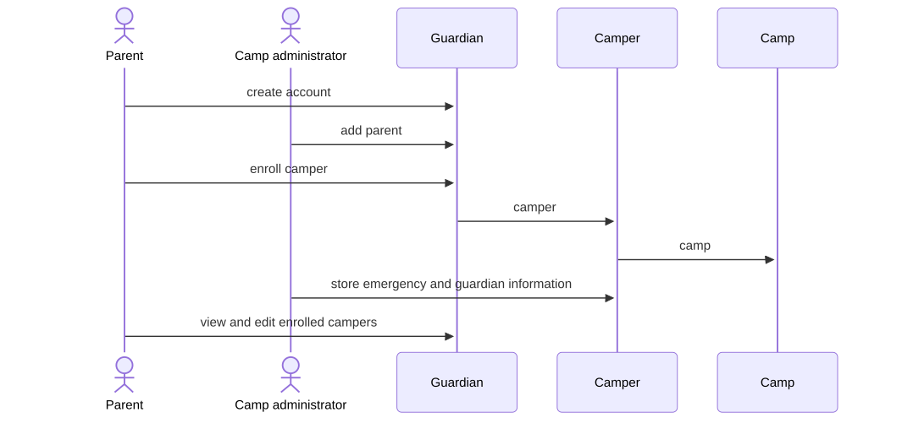](camperplus/sd1_enroll_camper.svg)

User stories covered

| # | User story |
|---|---|
| 15 | As a camp administrator, I want to store campers' emergency information in a database, so that I can easily notify the necessary parties in case of an emergency. |
| 16 | As a camp administrator, I want to store camper's immediate parent/guardian's information, so that I can easily call to notify them in case a grossly unacceptable behavior. |
| 24 | As a camp administrator, I want to be able to add parents, so that they can enroll their kids at camp. |
| 39 | As a parent, I want to be able to create an account, so that I can sign up my kids for camp online. |
| 46 | As a parent, I want to be able to enroll my campers, so that they can be admitted to camp. |
| 47 | As a parent, I want to be able to see and edit my enrolled campers to the camp year, so that I can know who I already enrolled to camp, who is still pending admission etc. |

### SD2 · Maintain camper and parent records

The camp administrator adds, modifies and removes campers, keeps records from previous years, and modifies or deletes parents.

[Mermaid source](../../4_gold_standard_sequence_diagrams/camperplus/sd2_maintain_records.mmd) · [SVG image](camperplus/sd2_maintain_records.svg)

[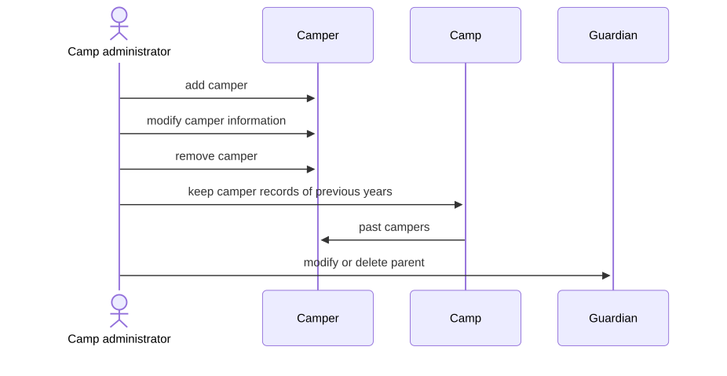](camperplus/sd2_maintain_records.svg)

User stories covered

| # | User story |
|---|---|
| 1 | As a camp administrator, I want to be able to add campers, so that I can keep track of each individual camper. |
| 2 | As a camp administrator, I want to be able to remove campers if they don't attend the camp anymore, so that I can keep the records organized. |
| 3 | As a camp administrator, I want to be able to keep camper records from previous years, so that the amount of work I need to do is lowered. |
| 30 | As a camp administrator, I want to be able to modify the information of enrolled campers, so that I can keep the campers information up to date. |
| 31 | As a camp administrator, I want to be able to delete campers from the database, so that I can keep my pages free of clutter. |
| 32 | As a camp administrator, I want to be able to modify the information of added parents, so that I can keep parent's information up to date. |
| 33 | As a camp administrator, I want to be able to delete parents from the database, so that I can keep my pages free of unneeded clutter. |

### SD3 · Handle forms

The camp administrator creates registration forms and uploads consent forms. Parents sign and submit forms and see what they submitted. The administrator tracks submissions and views medical forms.

[Mermaid source](../../4_gold_standard_sequence_diagrams/camperplus/sd3_forms.mmd) · [SVG image](camperplus/sd3_forms.svg)

[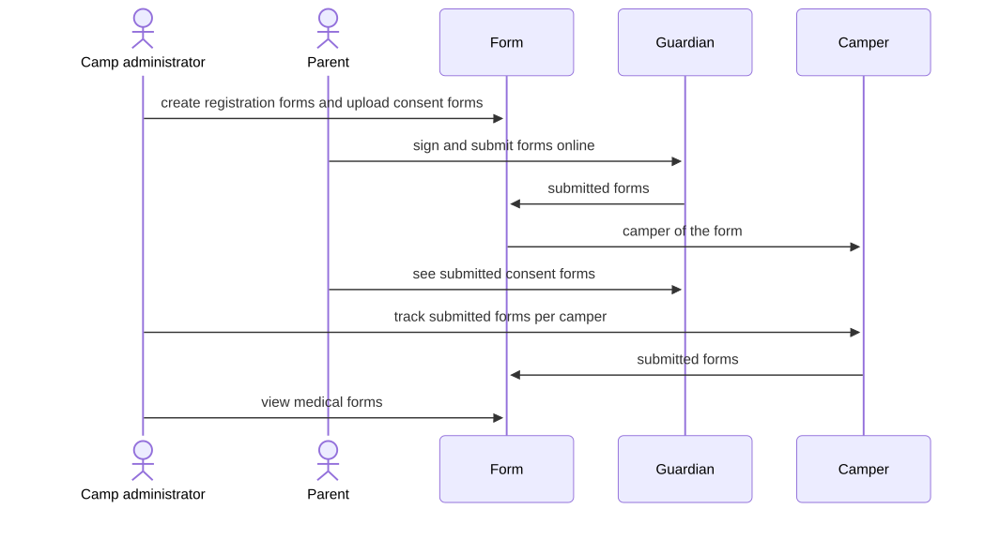](camperplus/sd3_forms.svg)

User stories covered

| # | User story |
|---|---|
| 4 | As a camp administrator, I want to be able to upload consent forms, so that campers or their parents can easily access the forms. |
| 5 | As a camp administrator, I want to be able to keep track of which camper submitted which forms, so that legal issues are avoided. |
| 19 | As a camp administrator, I want to be able to create a registration form for both staff and kids, so that I can keep organized. |
| 21 | As a camp administrator, I want to be able to see medical forms, so that we can be prepared for an allergy attack |
| 36 | As a parent, I want to be able to see which consent forms I have submitted, so that I can know what I still need to do. |
| 38 | As a parent, I want to be able to submit various type of forms to the camp management. |
| 42 | As a parent, I want to be able to sign and submit consent forms online, so that I don't have to deal with my camper losing a consent form. |

### SD4 · Organize groups and activities

The camp administrator creates groups, schedules activities for a group in a facility, changes scheduled activities, tracks the usage of the camp facilities and views the groups of the camp with their events.

[Mermaid source](../../4_gold_standard_sequence_diagrams/camperplus/sd4_groups_activities.mmd) · [SVG image](camperplus/sd4_groups_activities.svg)

[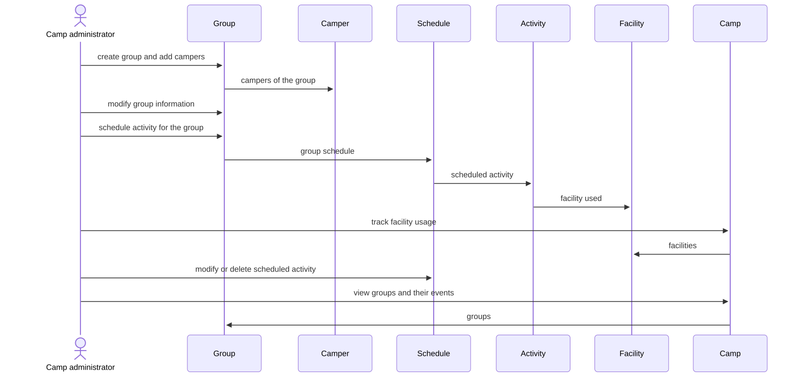](camperplus/sd4_groups_activities.svg)

User stories covered

| # | User story |
|---|---|
| 6 | As a camp administrator, I want to be able to schedule activities for campers, so that camp workers can easily keep track of who is where at all times. |
| 13 | As a camp administrator, I want to keep track of the usage of internal camp facilities, so that I don't create conflicting schedules for the different camp groups. |
| 25 | As a camp administrator, I want to be able to create groups and add campers to the groups, so that I can easily organize the campers. |
| 26 | As a camp administrator, I want to be able to see all my camp groups and the events scheduled for each camp group, so that I can notify counselor of what their group will be doing for the day. |
| 27 | As a camp administrator, I want to be able to schedule tasks/activities for a specific camp group, so that I can track each groups daily/weekly and monthly activities. |
| 28 | As a camp administrator, I want to be able to delete tasks/activities I scheduled, so that I can keep the schedule clean of unneeded activities. |
| 29 | As a camp administrator, I want to be able to modify tasks/events I scheduled in case there is a change, so that I can always keep the schedule up to date. |
| 34 | As a camp administrator, I want to be able to modify a group's information, so that I can keep the groups up to date. |
| 35 | As a camp administrator, I want to be able to see only events for a specific group/groups on the event calendar, so that I can easily read the data on the calendar without too much clutter. |

### SD5 · Follow a camper at camp

A parent follows the child's schedule and assigned counselors, checks the payments and shares photos.

[Mermaid source](../../4_gold_standard_sequence_diagrams/camperplus/sd5_parent_follows_camper.mmd) · [SVG image](camperplus/sd5_parent_follows_camper.svg)

[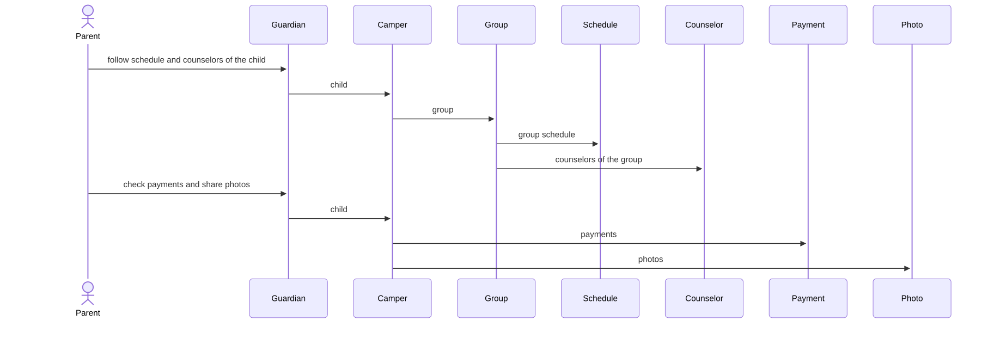](camperplus/sd5_parent_follows_camper.svg)

User stories covered

| # | User story |
|---|---|
| 37 | As a parent, I want to be able to track my camper activity and schedule at camp, so that I can have peace of mind. |
| 40 | As a parent, I want to see which counselors are assigned to my kids, so that I can have peace of mind. |
| 43 | As a parent, I want to be able to see if I made all the necessary payments. |
| 44 | As a parent, I want to be able to share any photos the camp has taken of my camper. |
| 48 | As a parent, I want to be able to see a schedule of the activities my campers are involved in at camp, so that I can be more informed as to what they are doing at camp. |

### SD6 · Exchange feedback and messages with parents

Parents submit feedback and concerns, receive bi-weekly feedback and notifications, message counselors and contact the staff in an emergency.

[Mermaid source](../../4_gold_standard_sequence_diagrams/camperplus/sd6_feedback_communication.mmd) · [SVG image](camperplus/sd6_feedback_communication.svg)

[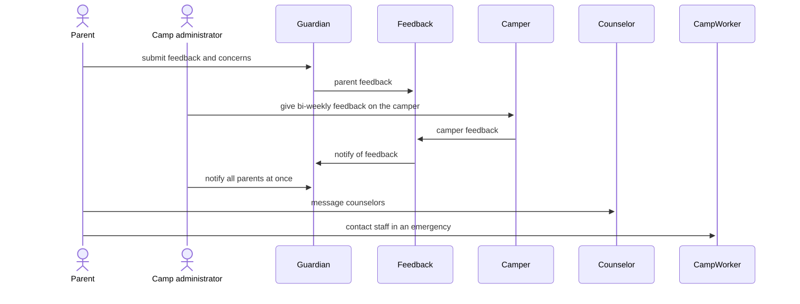](camperplus/sd6_feedback_communication.svg)

User stories covered

| # | User story |
|---|---|
| 14 | As a camp administrator, I want to create an avenue so parents can submit feedback and general concerns, so that I can keep improving the services I provide. |
| 17 | As a camp administrator, I want to provide bi-weekly feedback to camper's parents, so that they can be aware of their camper behavior and performance at camp. |
| 22 | As a camp administrator, I want to be able to notify parents all at once, so that they can be notified of any upcoming events. |
| 41 | As a parent, I want to be able to message my camper counselors, so that I can voice my concerns or check on my camper progress. |
| 45 | As a parent, I want to be able to connect with the staff in case of an emergency. |

### SD7 · Record attendance and behaviour

Counselors and the camp administrator record attendance. A camp worker reports inappropriate behaviour, and the administrator can suspend the camper.

[Mermaid source](../../4_gold_standard_sequence_diagrams/camperplus/sd7_attendance_behaviour.mmd) · [SVG image](camperplus/sd7_attendance_behaviour.svg)

[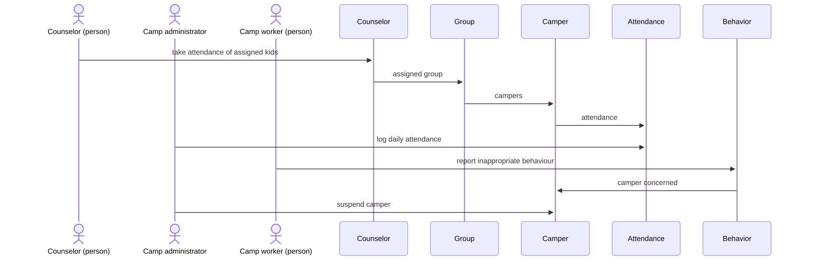](camperplus/sd7_attendance_behaviour.svg)

User stories covered

| # | User story |
|---|---|
| 8 | As a camp administrator, I want to be able to suspend a camper who had behavioral problems. |
| 23 | As a camp administrator, I want to be quickly log attendance everyday, so that I can track which kids are coming in. |
| 51 | As a camp worker, I want to report a camper to the manager with an inappropriate behavior. |
| 55 | As a camp counselor, I want to take attendance of my assigned kids, so that I can make ensure everybody is accounted for. |

### SD8 · Manage staff, rules and upkeep

The camp administrator assigns positions, warns camp workers and maintains the rules. Camp workers see the campers in their charge, submit reports, and report missing supplies and repairs.

[Mermaid source](../../4_gold_standard_sequence_diagrams/camperplus/sd8_staff_camp.mmd) · [SVG image](camperplus/sd8_staff_camp.svg)

[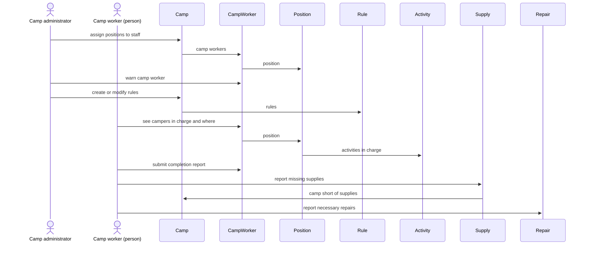](camperplus/sd8_staff_camp.svg)

User stories covered

| # | User story |
|---|---|
| 10 | As a camp administrator, I want to be able to assign different positions to the staff members, so that it is possible to organize activities in terms of responsibilities. |
| 11 | As a camp administrator, I want to be able to warn a camp worker who I think did his/her job inappropriate. |
| 12 | As a camp administrator, I want to be able to create, modify rules that campers and camp workers has to follow. |
| 49 | As a camp worker, I want to be able to see which campers I am in charge of and where, so that I can make sure I am doing my job properly. |
| 50 | As a camp worker, I want to submit a completion report for the tasks which was assigned to me. |
| 52 | As a camp worker, I want to report a list of supplies to the manager that the camp is short of. |
| 53 | As a camp worker, I want to report necessary repairs to the manager that the camp is needed of. |
| 54 | As a camp worker, I want to see which campers I am in charge of and where, so that I can make sure I am doing my job properly. |

## Fish & Chips

6 diagrams, 42 messages, 49 of 50 user stories covered (not covered: 20), 8 of 8 gold associations used. [User stories](../../1_user_stories/fish_chips.txt) · [Domain model](../fish_chips.svg)

### SD1 · Take an order

The cashier enters the products, special requests, order type and customer details, activates a coupon, and the customer reviews the order.

[Mermaid source](../../4_gold_standard_sequence_diagrams/fish_chips/sd1_take_order.mmd) · [SVG image](fish_chips/sd1_take_order.svg)

[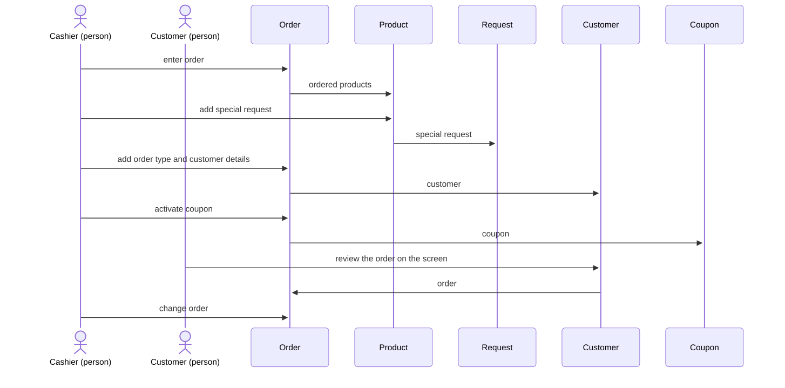](fish_chips/sd1_take_order.svg)

User stories covered

| # | User story |
|---|---|
| 23 | As a Customer, I want to have a screen during the ordering process, so that I can review the order. |
| 27 | As a Cashier, I want to make changes during the order, so that a misunderstanding with the customer or a mistake from me can be resolved. |
| 29 | As a Cashier, I want to add the type of order, so that the Ticket Master knows if he/she needs to hand the order directly to the customer or the delivery person. |
| 30 | As a Cashier, I want to add the pickup time for a takeaway order, so that the kitchen knows when to start preparing the order. |
| 32 | As a Cashier, I want to add the delivery address to the order, so that the delivery person knows where he needs to bring the order. |
| 33 | As a Cashier, I want to add the phone number to the order, so that the customer can be reached if there are problems with their order. |
| 34 | As a Cashier, I want to add the customer’s name to the order in the case of takeaway, so it is clear for the customer for which order to pay. |
| 35 | As a Cashier, I want to add special requests to a product they are concerned about, so that I can customize the order for the customer. |
| 38 | As a Cashier, I want to activate coupons during the order process, so that discounts can be added to the order. |

### SD2 · Pay for an order

The cashier offers payment methods and a tip, the order is paid, tickets go to the customer and the kitchen, and the kitchen is notified of the new order and of later changes.

[Mermaid source](../../4_gold_standard_sequence_diagrams/fish_chips/sd2_pay_order.mmd) · [SVG image](fish_chips/sd2_pay_order.svg)

[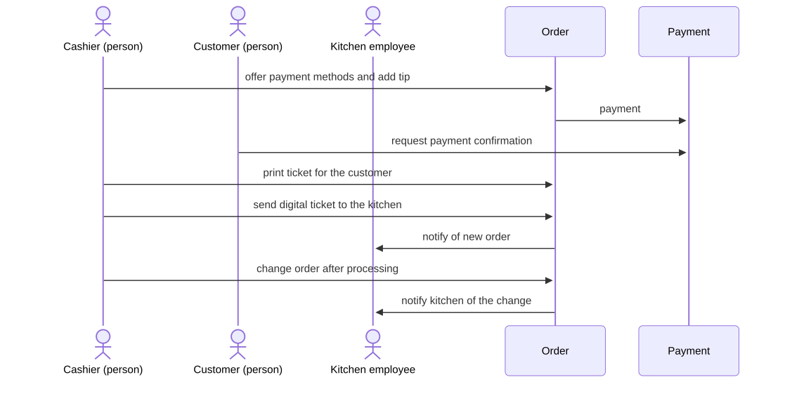](fish_chips/sd2_pay_order.svg)

User stories covered

| # | User story |
|---|---|
| 6 | As a Kitchen Employee, I want to receive a notification when a new order is received, so that I am aware of the new order. |
| 7 | As a Kitchen Employee, I want to receive a notification if the customer makes changes after the order is already paid, so that I know that there are changes to an order. |
| 24 | As a Customer, I want to be able to request a confirmation of payment, so that I am able to declare the costs or use it for my own administration. |
| 25 | As a Cashier, I want to have a physical ticket that shows the relevant information being printed automatically for the customer, so that I do not have to do that manually. |
| 26 | As a Cashier, I want to print a physical ticket that shows the relevant order details, so the customer has an insight into his order, and there will be no misunderstanding when the customer receives his order. |
| 28 | As a Cashier, I want to make changes after the order has been processed, so that the customer can make last-minute changes. |
| 31 | As a Cashier, I want to have a digital ticket sent to the kitchen, so that I do not have to walk physically to the kitchen. |
| 36 | As a Cashier, I want to offer different payment methods, so that a customer has multiple options to pay for their order. |
| 37 | As a Cashier, I want to be able to add a tip to the price of the order with all possible payment options, so that there is no hassle for the customer to tip. |

### SD3 · Prepare orders in the kitchen

A kitchen employee sees all orders with their status, and sees each order's number, products and special requests.

[Mermaid source](../../4_gold_standard_sequence_diagrams/fish_chips/sd3_kitchen_orders.mmd) · [SVG image](fish_chips/sd3_kitchen_orders.svg)

[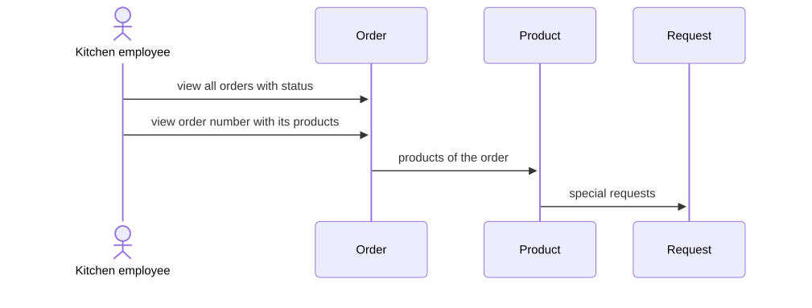](fish_chips/sd3_kitchen_orders.svg)

User stories covered

| # | User story |
|---|---|
| 1 | As a Kitchen Employee, I want to see the orders with their status, so that I am aware of the progress of each order. |
| 2 | As a Kitchen Employee, I want to have an overview of all orders at a glance, so that I cannot miss any relevant orders. |
| 3 | As a Kitchen Employee, I want to receive only the products of an order, so that I do not get confused by other irrelevant products. |
| 4 | As a Kitchen Employee, I want to see special requests to be shown together with the product they are concerned about, so that I know if I have to prepare a product in a special way |
| 5 | As a Kitchen Employee, I want to have the order number shown together with its related products, so that I am aware of which order the products are coming from. |

### SD4 · Track the status of orders

The ticket master views orders by status, selects an order to see product statuses and order type, labels products with a status and deletes delivered orders.

[Mermaid source](../../4_gold_standard_sequence_diagrams/fish_chips/sd4_track_status.mmd) · [SVG image](fish_chips/sd4_track_status.svg)

[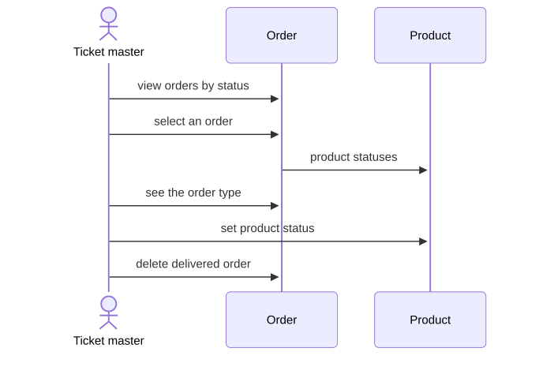](fish_chips/sd4_track_status.svg)

User stories covered

| # | User story |
|---|---|
| 8 | As a Ticket Master, I want to label new orders as ‘incoming orders’, so that incoming orders can be separated from orders with a different status. |
| 9 | As a Ticket Master, I want to label a product as ‘current orders’ at the moment the preparation of the products is started, so that current orders can be separated from orders with a different status. |
| 10 | As a Ticket Master, I want to label a product as ‘finished orders’ after the preparation of the products is finished, so that finished orders can be separated from orders with a different status. |
| 11 | As a Ticket Master, I want to label products as ‘scheduled orders’ if their requested time is not yet within ten minutes, so that scheduled orders can be separated from orders with a different status. |
| 12 | As a Ticket Master, I want to have an overview of all the incoming orders, so that I know how many orders should still be prepared. |
| 13 | As a Ticket Master, I want to have an overview of all orders that are currently made by the kitchen, so that I know how many orders are in progress. |
| 14 | As a Ticket Master, I want to have an overview of all orders that are completed by the kitchen, so that I know when I should start packing an order. |
| 15 | As a Ticket Master, I want to have an overview of all scheduled orders, so that I have an insight into the orders that are scheduled for a later time in the day. |
| 16 | As a Ticket Master, I want to separate the scheduled orders from the other statuses, so that the focus will be on the most relevant orders. |
| 17 | As a Ticket Master, I want to see the statuses of the products of an order, so that I have a good insight into the progress of an order. |
| 18 | As a Ticket Master, I want to see matching colors with the status of each product, so that the status of an order is easier to see at a glance. |
| 19 | As a Ticket Master, I want to see the order type, so that I know if I need to bring the order to the customer or hand it to our delivery person. |
| 21 | As a Ticket Master, I want to select orders, so that I can make changes to their status. |
| 22 | As a Ticket Master, I want to delete an order, so that no delivered orders are being shown and I can keep a better overview of the orders being in progress. |

### SD5 · Deliver an order to the customer's home

The home delivery person gets the delivery address early and a ticket with address, price and phone number. The owner records the cash received by delivery people.

[Mermaid source](../../4_gold_standard_sequence_diagrams/fish_chips/sd5_home_delivery.mmd) · [SVG image](fish_chips/sd5_home_delivery.svg)

[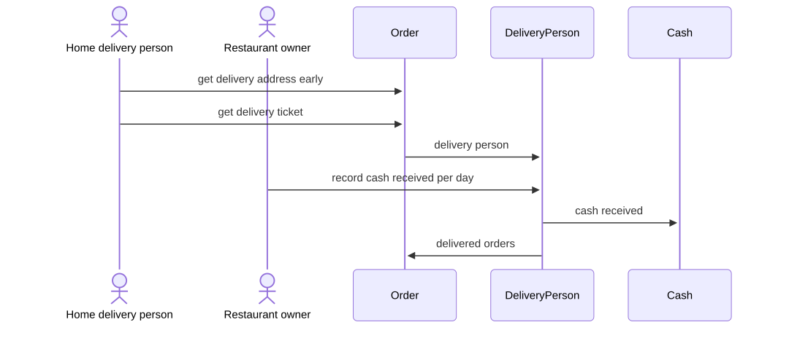](fish_chips/sd5_home_delivery.svg)

User stories covered

| # | User story |
|---|---|
| 46 | As a Restaurant Owner, I want to fill in the amount of cash the delivery people receive per day, so that this value can be compared with the expected revenue of home delivery orders per day. |
| 47 | As a Home Delivery Person, I want to have the address printed on the ticket, so that I can directly type the address into the navigation system. |
| 48 | As a Home Delivery Person, I want to have the delivery address before the order is finished, so that I can combine orders that need to be delivered in the same area. |
| 49 | As a Home Delivery Person, I want to have the order price on a printed ticket, so that I know what the customers have to pay me. |
| 50 | As a Home Delivery Person, I want to know the phone number of the customer on a printed ticket, so that I can call the customer if I have some problems delivering the food to a certain location. |

### SD6 · Review sales and balances

The restaurant owner views VAT, type and price per order and the sold products, searches for an order, records tips and checks cashier balances.

[Mermaid source](../../4_gold_standard_sequence_diagrams/fish_chips/sd6_owner_reports.mmd) · [SVG image](fish_chips/sd6_owner_reports.svg)

[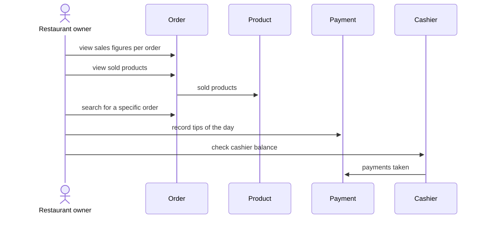](fish_chips/sd6_owner_reports.svg)

User stories covered

| # | User story |
|---|---|
| 39 | As a Restaurant Owner, I want to see the VAT of each order, so that I have an overview of the taxes. |
| 40 | As a Restaurant Owner, I want to see the sold products, so that I know what products to purchase for restocking the inventory. |
| 41 | As a Restaurant Owner, I want to have an overview of the types of orders. |
| 42 | As a Restaurant Owner, I want to have an overview of prices per order so that I have an insight into the daily revenue. |
| 43 | As a Restaurant Owner, I want to search for specific orders if a customer has questions about an order. |
| 44 | As a Restaurant Owner, I want to fill in the number of tips received on a day by the restaurant and the delivery employees, so that this amount can be fairly distributed among all employees. |
| 45 | As a Restaurant Owner, I want to have cashier accounts, so that I can check their balance at the end of a shift. |

## Grocery

6 diagrams, 54 messages, 42 of 49 user stories covered (not covered: 5, 11, 39, 41–42, 46, 49), 11 of 11 gold associations used. [User stories](../../1_user_stories/grocery.txt) · [Domain model](../grocery.svg)

### SD1 · Pay salaries and send statements

The manager offers weekly or monthly payments and sends salary statements. Work hours are verified, the salary is paid, and the employee is notified.

[Mermaid source](../../4_gold_standard_sequence_diagrams/grocery/sd1_salary_payment.mmd) · [SVG image](grocery/sd1_salary_payment.svg)

[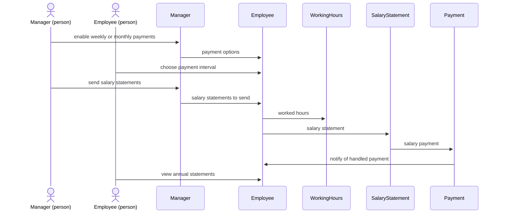](grocery/sd1_salary_payment.svg)

User stories covered

| # | User story |
|---|---|
| 1 | As an employee, I want to receive my salary statement, so that I have a clear overview. |
| 2 | As a manager, I want to send salary statements, so that my employees have a clear overview. |
| 3 | As a manager, I want to enable the option for weekly and monthly payments for my employees, so that employee satisfaction rises. |
| 4 | As a manager, I want to automate the payment system, so that all payments are handled correctly and on time. |
| 6 | As an employee, I want to receive a notification when my salary payment is handled, so that I stay up to date with my financial status. |
| 15 | As an employee, I want the system to automatically verify my work hours, so that my salary statements are calculated accurately. |
| 16 | As a manager, I want the system to automatically verify employees' work hours, so that employees' salary statements are calculated accurately. |
| 44 | As an employee, I want to be able to choose between weekly or monthly payments, so that I can adjust my payment routine to my lifestyle. |
| 45 | As an employee, I want to be able to view my financial annual statements, so that I can easily find my financial information for filing taxes, etc. |

### SD2 · Create and publish the schedule

Employees state preferred working hours. The manager generates, adjusts and authorizes the schedule, and employees are notified and view it.

[Mermaid source](../../4_gold_standard_sequence_diagrams/grocery/sd2_scheduling.mmd) · [SVG image](grocery/sd2_scheduling.svg)

[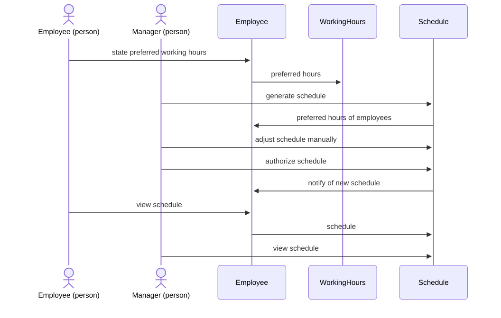](grocery/sd2_scheduling.svg)

User stories covered

| # | User story |
|---|---|
| 7 | As an employee, I want to express my preferred working hours, so that I am most likely to work on hours that best suit me. |
| 8 | As a manager, I want to semi-automate the scheduling process, so that the scheduling process is more efficient. |
| 9 | As a manager, I want to have the ability to manually edit the automatically-generated  schedule,  so that  I  can keep the operations running on busy days. |
| 10 | As a manager, I want to manually authorize the schedule before it goes live, so that I can ensure a correct schedule is being shared. |
| 12 | As an employee, I want to receive notification when the new schedule is available, so that I can keep the scheduled hours free from other activities. |
| 13 | As an employee, I want to view the schedule at any given time, so that I can effectively keep track of my personal time. |
| 14 | As a manager, I want to view the schedule at any given time, so that I can effectively manage the employee presence on the work floor. |

### SD3 · File and handle a complaint

Employees and managers file complaints about the workplace. Office employees and managers view them, an office employee categorizes, prioritizes and responds, and the employee is notified.

[Mermaid source](../../4_gold_standard_sequence_diagrams/grocery/sd3_complaints.mmd) · [SVG image](grocery/sd3_complaints.svg)

[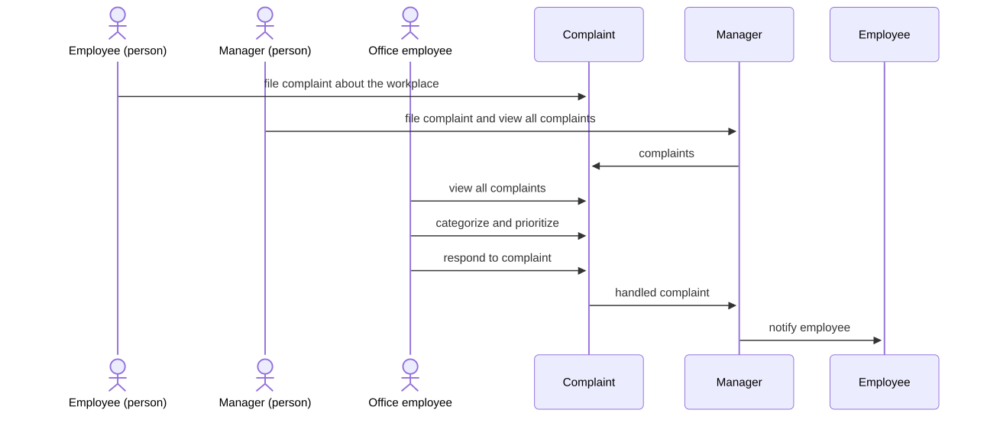](grocery/sd3_complaints.svg)

User stories covered

| # | User story |
|---|---|
| 17 | As an office employee, I want a separate complaint system with tickets, so that I don’t have to filter through my email for complaints anymore. |
| 18 | As an employee, I want to be able to file a complaint regarding my workplace, so that my problems can be solved. |
| 19 | As a manager, I want to be able to file a complaint regarding my workplace, so that my problems can be solved. |
| 20 | As a manager, I want my employees to be able to file complaints regarding their workplace, so that employee satisfaction rises. |
| 21 | As an office employee, I want to be able to view all complaints, so that I can have an overview of the problems other employees face. |
| 22 | As a manager, I want to be able to view all complaints, so that I can have an overview of the problems my employees face. |
| 23 | As an office employee, I want to be able to respond to unsolved complaints, so that I can help the employees with their problems. |
| 24 | As an office employee, I want to be able to categorize complaints, so that there is an overview of the extent of problem areas. |
| 25 | As an office employee, I want to be able to prioritize complaints that require high management intervention to solve, so that important complaints will be solved swiftly. |
| 26 | As an employee, I want to receive a notification when my filed complaint is handled, so that I can stay up to date with the status of my complaint. |

### SD4 · Hire and review staff

The manager hires new employees, an applicant registers an account and the manager is notified. The manager reviews employees, their contracts and certificates.

[Mermaid source](../../4_gold_standard_sequence_diagrams/grocery/sd4_hiring_staff.mmd) · [SVG image](grocery/sd4_hiring_staff.svg)

[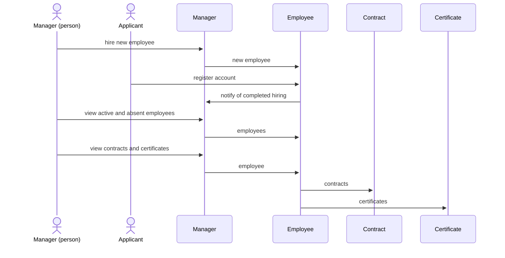](grocery/sd4_hiring_staff.svg)

User stories covered

| # | User story |
|---|---|
| 27 | As a  manager,  I  want  to  be  able  to quickly and effectively hire new employees, so that I can easily scale up our operations. |
| 28 | As a manager, I want to be notified when the hiring process of an employee is finished, so that I am up to date regarding the status of our new employees. |
| 29 | As a manager, I want to be able to have an overview of all our active employees, so that I can easily evaluate our employees. |
| 30 | As a manager, I want to be able to have an overview of all our absent employees, so that I can manually verify these absences. |
| 31 | As an applicant, I want to be able to register an account, so that I can finalize my hiring process and start working at the organization. |
| 32 | As a manager, I want to be able to view my employee’s contracts at any given time, so that I have a clear overview of when extensions are due. |
| 33 | As a manager, I want to be able to view my employee’s certificates at any given time, so that I have a clear overview of the qualifications of my employees. |

### SD5 · Exchange messages

Employees message the management and colleagues, the manager messages one employee or many, and employees read their inbox.

[Mermaid source](../../4_gold_standard_sequence_diagrams/grocery/sd5_messaging.mmd) · [SVG image](grocery/sd5_messaging.svg)

[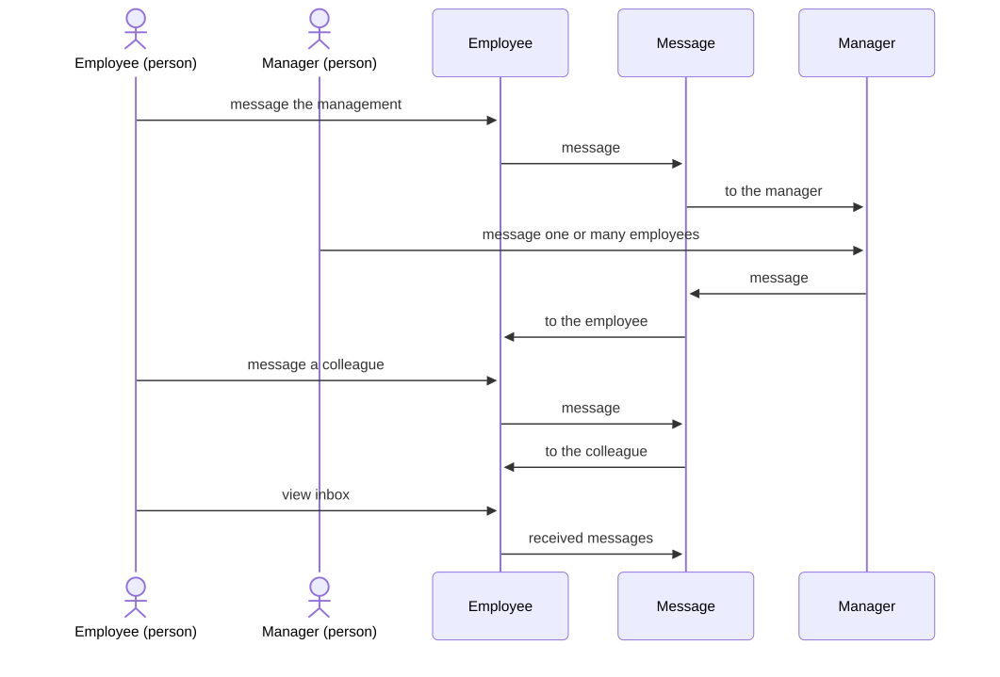](grocery/sd5_messaging.svg)

User stories covered

| # | User story |
|---|---|
| 34 | As an employee, I want to be able to contact the management when needed, so that I can discuss important topics regarding my employment with them. |
| 35 | As a manager, I want to be able to contact an employee easily, so I can reach them when needed. |
| 36 | As an employee, I want to be able to use the messaging system to message other employees when needed, so that I can keep in touch with my colleagues. |
| 37 | As a manager, I want to be able to forward formal messages to employees in bulk, so that I can communicate with a big group of employees when needed. |
| 38 | As an employee, I want to view my personal inbox easily, so that I have a clear overview of important work-related information. |

### SD6 · Manage the personal account

An employee changes personal information, chooses the notification channel, resets the password and views the contract.

[Mermaid source](../../4_gold_standard_sequence_diagrams/grocery/sd6_personal_account.mmd) · [SVG image](grocery/sd6_personal_account.svg)

[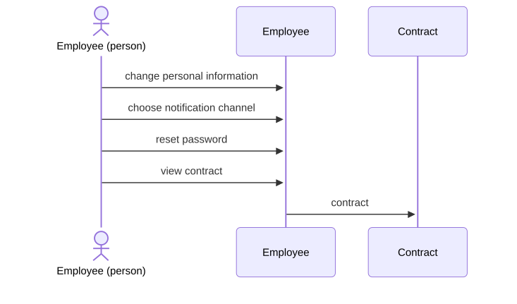](grocery/sd6_personal_account.svg)

User stories covered

| # | User story |
|---|---|
| 40 | As an employee, I want to be able to reset my password, so that I can always access my account. |
| 43 | As an employee, I want to be able to choose between email or application notifications, so that I can adjust my administration in the way that I prefer. |
| 47 | As an employee, I want to be able to change my personal information, so that the information my employer has is always up to date. |
| 48 | As an employee, I want to be able to view my contract, so that I have a clear overview of important work-related information. |

## Planningpoker

7 diagrams, 41 messages, 32 of 53 user stories covered (not covered: 21–26, 37–38, 40, 42–53), 6 of 6 gold associations used. [User stories](../../1_user_stories/planningpoker.txt) · [Domain model](../planningpoker.svg)

### SD1 · Set up a game

The moderator creates a game, chooses the card deck and invites the estimators.

[Mermaid source](../../4_gold_standard_sequence_diagrams/planningpoker/sd1_set_up_game.mmd) · [SVG image](planningpoker/sd1_set_up_game.svg)

User stories covered

| # | User story |
|---|---|
| 1 | As a moderator, I want to create a new game by entering a name and an optional description, so that I can start inviting estimators. |
| 2 | As a moderator, I want to invite estimators by giving them a URL where they can access the game, so that we can start the game. |
| 27 | As a moderator, I want to select whether to have the team estimate with {0, 1/2, 1, 2, 3, 5, 8, etc.} or {0, 1, 2, 4, 8, 16, 32, etc.}, so that the team can use either the modified Fibonacci sequence or powers of 2. |
| 28 | As a moderator, I want to invite up to 15 estimators, so that we can play with large but not immense teams. |

### SD2 · Join a game

An estimator joins the game through the invitation URL by entering a name.

[Mermaid source](../../4_gold_standard_sequence_diagrams/planningpoker/sd2_join_game.mmd) · [SVG image](planningpoker/sd2_join_game.svg)

User stories covered

| # | User story |
|---|---|
| 29 | As an estimator, I want to join a game by entering my name on the page I received the URL for, so that I can participate. |

### SD3 · Prepare and maintain the items

The moderator starts a round with an item, imports further items and adds, edits or deletes items. Moderator and estimators see the items of the round.

[Mermaid source](../../4_gold_standard_sequence_diagrams/planningpoker/sd3_manage_items.mmd) · [SVG image](planningpoker/sd3_manage_items.svg)

User stories covered

| # | User story |
|---|---|
| 3 | As a moderator, I want to start a round by entering an item in a single multi-line text field, so that we can estimate it. |
| 4 | As a moderator, I want to see all items we try to estimate this round, so that I can answer questions about the current item such as "does this include ___". |
| 6 | As a moderator, I want to add an item to the list of items to be estimated, so that so that we can be flexible and accommodate situations where we think of a new item while playing. |
| 7 | As a moderator, I want to edit an item in the list of items to be estimated, so that I can make it better reflect the team's understanding of the item. |
| 8 | As a moderator, I want to delete an item from the list of items to be estimated, so that we can remove it and not estimate it. |
| 14 | As a moderator, I want to import items from a spreadsheet, so that I don't have to copy and paste each individual item. |
| 15 | As a moderator, I want to copy/paste items from a spreadsheet, so that I can get started more quickly. |
| 31 | As an estimator, I want to see all items we will try to estimate this round, so that I have a feel for the sizes of the various items. |

### SD4 · Estimate an item

The moderator selects an item, the estimators play a card and can change it until the estimates are shown. Everyone sees who has already estimated.

[Mermaid source](../../4_gold_standard_sequence_diagrams/planningpoker/sd4_estimate_item.mmd) · [SVG image](planningpoker/sd4_estimate_item.svg)

User stories covered

| # | User story |
|---|---|
| 5 | As a moderator, I want to select an item to be estimated or re-estimated, so that the team sees that item and can estimate it. |
| 30 | As an estimator, I want to see the item we’re estimating, so that I know what I’m giving an estimate for. |
| 32 | As a participant, I want to immediately see that an estimate has been given by a specific estimator, so that I know who has already given an estimate and who we’re still waiting for. |
| 34 | As a participant, I want to be able to change my estimate up until the last person selects a card and all are shown, so that I can change my mind based on information I hear. |
| 41 | As a participant, I want to change my estimate as long as the draw has not been completed, so that I can change my mind. |

### SD5 · Reveal and accept the estimates

The estimates are shown to everyone at the same time, and the moderator accepts the average or the agreed estimate.

[Mermaid source](../../4_gold_standard_sequence_diagrams/planningpoker/sd5_reveal_accept.mmd) · [SVG image](planningpoker/sd5_reveal_accept.svg)

User stories covered

| # | User story |
|---|---|
| 9 | As a moderator, I want to show all estimates immediately, so that I can decide to show the estimates that have been given even though not all estimators have given their estimate. |
| 10 | As a moderator, I want to accept the average of all estimates, so that we can move on to the next item when we agree. |
| 11 | As a moderator, I want to have the "estimate" field filled in automatically if all estimators show the same card, so that I can accept it more quickly. |
| 12 | As a moderator, I want to enter the agreed-upon estimate, so that we can move on to the next item when we agree. |
| 33 | As a participant, I want to be shown all estimates at the same time after all estimators have given their estimate, so that I can be sure estimates are independent and not influenced by other estimates given in the same draw. |
| 36 | As a participant, I want to see who gave what estimates during the current round, so that I know this when we’re discussing the estimates. |

### SD6 · Look back and re-estimate

A participant scrolls back through earlier rounds. The moderator reopens an earlier item, and participants see each estimator's prior estimates.

[Mermaid source](../../4_gold_standard_sequence_diagrams/planningpoker/sd6_look_back.mmd) · [SVG image](planningpoker/sd6_look_back.svg)

User stories covered

| # | User story |
|---|---|
| 13 | As a moderator, I want to estimate a item we estimated earlier in the round again, so that we can give a new estimate if we feel different about the item after estimating other related items. |
| 35 | As a participant, I want to be able to see each estimator's prior estimates for the item being estimated, so that I can see how his or her opinion has changed so I can ask questions. |
| 39 | As a participant, I want to scroll back through the items and estimates from prior rounds, so that I can use this information when I estimate the item of the current round. |

### SD7 · Manage previous games

The moderator browses previous games, views and exports a transcript, and deletes a game.

[Mermaid source](../../4_gold_standard_sequence_diagrams/planningpoker/sd7_previous_games.mmd) · [SVG image](planningpoker/sd7_previous_games.svg)

User stories covered

| # | User story |
|---|---|
| 16 | As a moderator, I want to browse through previous games, so that I can find the previous game I’m looking for. |
| 17 | As a moderator, I want to view a transcript of a game, so that I can see the items and estimates. |
| 18 | As a moderator, I want to export a transcript of a game as a HTML file, so that I can save the items and estimates locally. |
| 19 | As a moderator, I want to export a transcript of a game as a CSV file, so that I can further process the items and estimates. |
| 20 | As a moderator, I want to delete a game, so that items and estimates for this game are no longer stored. |

## Recycling

7 diagrams, 43 messages, 32 of 51 user stories covered (not covered: 9–10, 13, 19–20, 22–25, 27, 29, 31–35, 41, 45, 51), 8 of 10 gold associations used. [User stories](../../1_user_stories/recycling.txt) · [Domain model](../recycling.svg)

### SD1 · Find recycling facilities

A user finds nearby facilities by zip code and on a map, narrows them by waste type and opening hours, and opens an address in Google Maps.

[Mermaid source](../../4_gold_standard_sequence_diagrams/recycling/sd1_find_facilities.mmd) · [SVG image](recycling/sd1_find_facilities.svg)

[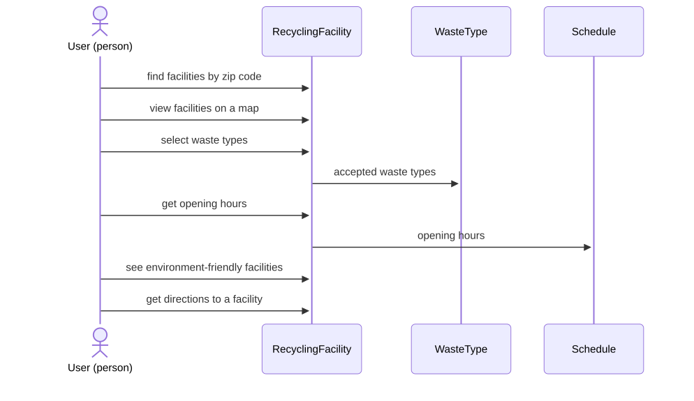](recycling/sd1_find_facilities.svg)

User stories covered

| # | User story |
|---|---|
| 1 | As a user, I want to click on the address, so that it takes me to a new tab with Google Maps. |
| 2 | As a user, I want to be able to anonymously view public information, so that I know about recycling centers near me before creating an account. |
| 3 | As a user, I want to be able to enter my zip code and get a list of nearby recycling facilities, so that I can determine which ones I should consider. |
| 4 | As a user, I want to be able to get the hours of each recycling facility, so that I can arrange drop-offs on my off days or during after-work hours. |
| 6 | As a user, I want to be able to select different types of recyclable waste, so I have and get a list of facilities that accept each type and their opening hours, so that I can find an optimal route and schedule. |
| 14 | As a user, I want to get feedback when I enter an invalid zip code. |
| 36 | As a user, I want to view all locations of recycling centers on a map, so that I can check which routes to take to drop off waste. |
| 48 | As a user, I want to be able to browse through the list of facolities and see which ones are environment-friendly, so that I can know for sure my waste is not going to leave a negative ecological footprint. |

### SD2 · Plan a drop-off

A user uploads a weekly schedule, gets fitting recycling centers recommended and chooses a flexible pick-up time.

[Mermaid source](../../4_gold_standard_sequence_diagrams/recycling/sd2_plan_drop_off.mmd) · [SVG image](recycling/sd2_plan_drop_off.svg)

[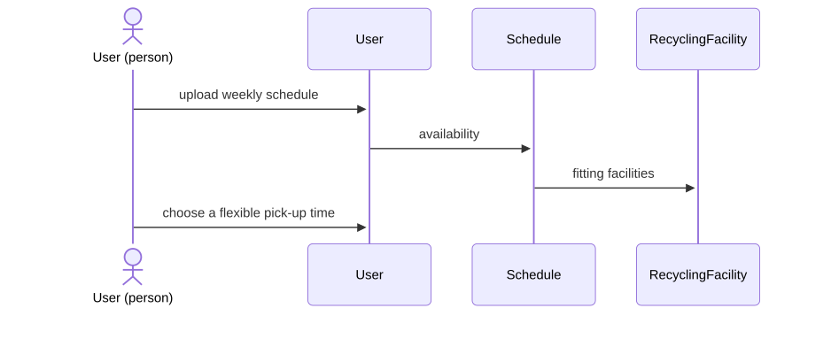](recycling/sd2_plan_drop_off.svg)

User stories covered

| # | User story |
|---|---|
| 5 | As a user, I want to have a flexible pick up time, so that I can more conveniently use the website. |
| 12 | As a user, I want to choose a flexible pick up time, so that I can more conveniently use the website. |
| 37 | As a user, I want to upload my week's schedule, so that I can get recommendations for recycling centers that best fit my availability. |

### SD3 · Follow safe disposal events

A user views the safe disposal events in the area and leaves an email address to be notified of new events.

[Mermaid source](../../4_gold_standard_sequence_diagrams/recycling/sd3_disposal_events.mmd) · [SVG image](recycling/sd3_disposal_events.svg)

[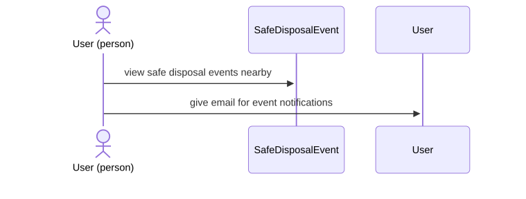](recycling/sd3_disposal_events.svg)

User stories covered

| # | User story |
|---|---|
| 8 | As a user, I want to be able to give my email ID, so that I can receive notifications for new events as they are posted. |
| 11 | As a user, I want to be able to view the safe disposal events currently being organised around my area. |

### SD4 · Manage the user account

A user creates an account, links an email account, saves favorite donation centers, and looks up rewards and the transaction history. An admin can block a spamming user.

[Mermaid source](../../4_gold_standard_sequence_diagrams/recycling/sd4_account.mmd) · [SVG image](recycling/sd4_account.svg)

[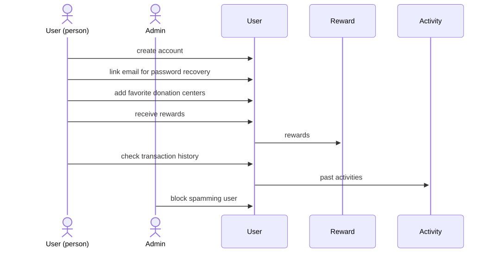](recycling/sd4_account.svg)

User stories covered

| # | User story |
|---|---|
| 7 | As a user, I want to add donation centers as favorites on my profile, so that I can view them later. |
| 15 | As a user, I want to be able to create an acocunt, so that I can create my own profile. |
| 18 | As a user, I want to be able to check transaction history and keep a record of it, so that I can go back when needed. |
| 21 | As an admin, I want to be able to block specific users based on IP address, so that I can prevent spamming on the websites. |
| 28 | As a user, I want to be able to receive tempting rewards, so that I have a reason to use the website. |
| 38 | As a user, I want to link my email account to my profile, so that I can get a temporary password in case I forget my own one. |

### SD5 · Give feedback and complain

A user contacts the administrators with feedback or a complaint, and an admin reads them.

[Mermaid source](../../4_gold_standard_sequence_diagrams/recycling/sd5_feedback.mmd) · [SVG image](recycling/sd5_feedback.svg)

[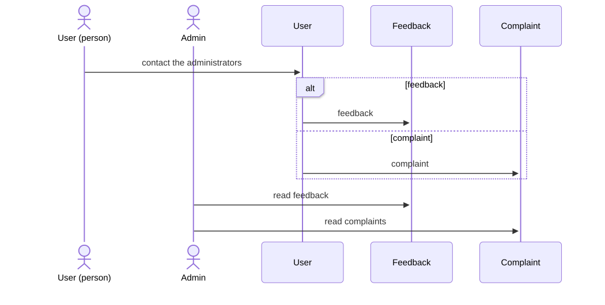](recycling/sd5_feedback.svg)

User stories covered

| # | User story |
|---|---|
| 17 | As an admin, I want to be able to read users' feedback and complaints, so that we can add more features and keep improving the service we provide to them. |
| 39 | As a user, I want to contact the administrators, so that I can give feedback or ask for help. |

### SD6 · Maintain facility information

An admin onboards recycling centers and adds or removes their information. Superusers and facility representatives keep it up to date, and the admin sends updates to the facilities.

[Mermaid source](../../4_gold_standard_sequence_diagrams/recycling/sd6_maintain_facilities.mmd) · [SVG image](recycling/sd6_maintain_facilities.svg)

[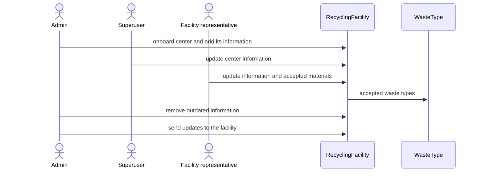](recycling/sd6_maintain_facilities.svg)

User stories covered

| # | User story |
|---|---|
| 16 | As an admin, I want to be able to add or remove recycling facilities' information, so that users get the most recent information. |
| 40 | As an admin, I want to add recycling center information, so that I can keep the database up-to-date over time. |
| 42 | As an admin, I want to onboard recycling centers on the platform, so that I can increase information accuracy. |
| 43 | As a superuser, I want to update the recycling center information, so that I can provide the latest information about the recycling center. |
| 47 | As an admin, I want to be able to communicate directly with facilities, so that I can keep them updated about features we have on our website. |
| 49 | As a recyclingfacility representative, I want to be able to update my information and the type of material I accept, so that I can avoid any miscommunication with users. |

### SD7 · Review usage and staff information

Superusers and facility representatives view user statistics for their center, an admin handles user activities and views a usage dashboard, and HR views employee information.

[Mermaid source](../../4_gold_standard_sequence_diagrams/recycling/sd7_usage_staff.mmd) · [SVG image](recycling/sd7_usage_staff.svg)

[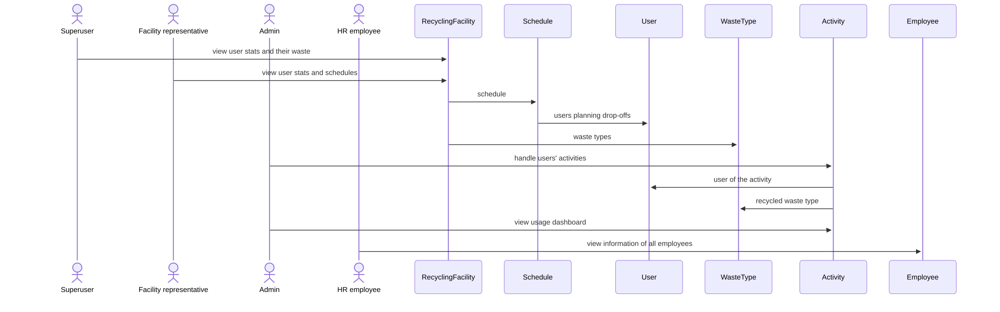](recycling/sd7_usage_staff.svg)

User stories covered

| # | User story |
|---|---|
| 26 | As an employee from the HR department, I want to have access to the full information of all employees working for this business. |
| 30 | As an admin, I want to handle all users' activities, so that I can manage more efficiently. |
| 44 | As a superuser, I want to view users' stats, so that I can view in real-time how many users have visited my recycling center information and their recyclable waste. |
| 46 | As an admin, I want to be able to have a dashboard that shows usage stats and locations, so that I can identify the neighbourhoods with the largest number of drop-offs and to try getting more facilities involved. |
| 50 | As a recyclingfacility representative, I want to have access to user stats and schedules, so that I can adjust my hours and/or upgrade equipment and capacity in order to be able to accomodate larger amounts of recyclable materials. |

## School

9 diagrams, 87 messages, 56 of 61 user stories covered (not covered: 47, 50–51, 58, 60), 24 of 24 gold associations used. [User stories](../../1_user_stories/school.txt) · [Domain model](../school.svg)

### SD1 · Send messages

Guardians, students, teachers and administrators send direct messages, administrators also broadcasts, and each recipient is notified of a new message.

[Mermaid source](../../4_gold_standard_sequence_diagrams/school/sd1_messaging.mmd) · [SVG image](school/sd1_messaging.svg)

[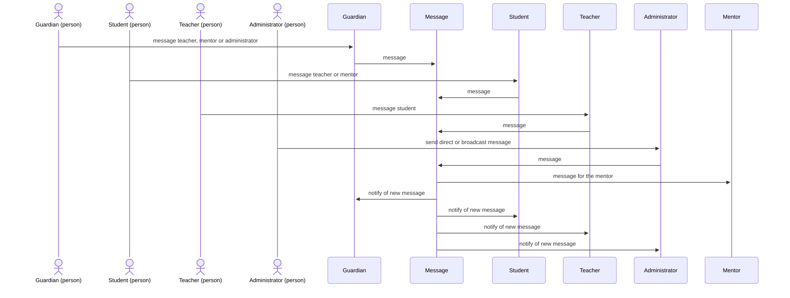](school/sd1_messaging.svg)

User stories covered

| # | User story |
|---|---|
| 1 | As a guardian, I want to directly message any teacher of my child, the mentor assigned to my child, or an administrative staff member, so that I can contact them when needed. |
| 3 | As a guardian, I want to receive a notification when I receive a message, so that I do not have to manually check for new messages. |
| 6 | As a student, I want to directly message any of my teachers, so that I can directly communicate with them when needed. |
| 7 | As a student, I want to directly message my mentor, so that I can directly communicate with my her when needed. |
| 12 | As a student, I want to receive a notification when I receive a message, so that I do not have to manually check for new messages. |
| 27 | As a teacher, I want to directly message any student that is assigned to my class, so that I am able to have contact with any participants of my class. |
| 28 | As a teacher, I want to directly message any student to which I am assigned mentor, so that I can gain insight into the performance of my students. |
| 34 | As a teacher, I want to receive a notification when I receive a message, so that I do not have to manually check for new messages. |
| 48 | As an administrator I want to send direct messages to any student, guardian, teacher, or administrator, so that I am able to quickly contact them if needed. |
| 53 | As an administrator, I want to receive a notification when I receive a message so that I do not have to manually check for new messages. |
| 57 | As an administrator, I want to send broadcast messages to multiple selected teachers, students, guardians, classes, or other administrators, so that I do not have to manually send the same message to multiple participants. |

### SD2 · Build a digital learning module

A teacher creates a module with content and question pages, answers and a submission element, edits pages, and assigns the module to a class with dates.

[Mermaid source](../../4_gold_standard_sequence_diagrams/school/sd2_build_module.mmd) · [SVG image](school/sd2_build_module.svg)

[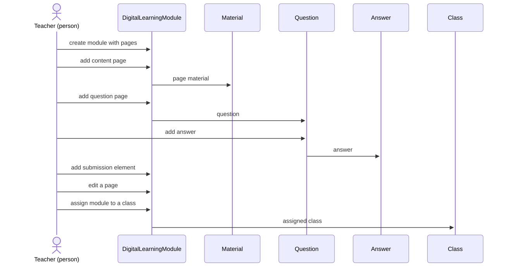](school/sd2_build_module.svg)

User stories covered

| # | User story |
|---|---|
| 20 | As a teacher, I want to add a page containing a video to a DLM, so that video material can be used within a DLM. |
| 21 | As a teacher, I want to add a page containing text and pictures to a DLM, so that this material can be used within a DLM. |
| 22 | As a teacher, I want to add a page that contains a multiple-choice question or an open question to a DLM, so that I can test the student’s knowledge. |
| 23 | As a teacher, I want to assign a DLM to a specific class or student(s), so that the DLM is accessible by the right user. |
| 24 | As a teacher, I want to assign a due date to a DLM, so that students can be informed about when they are expected to finish a DLM. |
| 26 | As a teacher, I want to create digital learning modules containing pages, so that I can create interactive study material. |
| 29 | As a teacher, I want to edit any page contained within a DLM, so that I do not have to create a new DLM if the need arises to change a minor detail. |
| 30 | As a teacher, I want to make submission elements, so that students can submit assignments that they have made. |
| 31 | As a teacher, I want to optionally add the corresponding answer to a question page contained within a DLM, so that it can be used to correct a submitted DLM. |
| 42 | As a teacher, I want to set an appearance date to a DLM, so that students are only able to access the DLM after the appearance date has passed. |
| 43 | As a teacher, I want to set available dates and times either to instant or a specific date and time combination, so that I am able to upload the material in advance. |

### SD3 · Share files and hand in homework

A teacher uploads files for classes and students are notified. Students open the files and modules of their class and hand in homework, and the teacher is notified.

[Mermaid source](../../4_gold_standard_sequence_diagrams/school/sd3_files_homework.mmd) · [SVG image](school/sd3_files_homework.svg)

[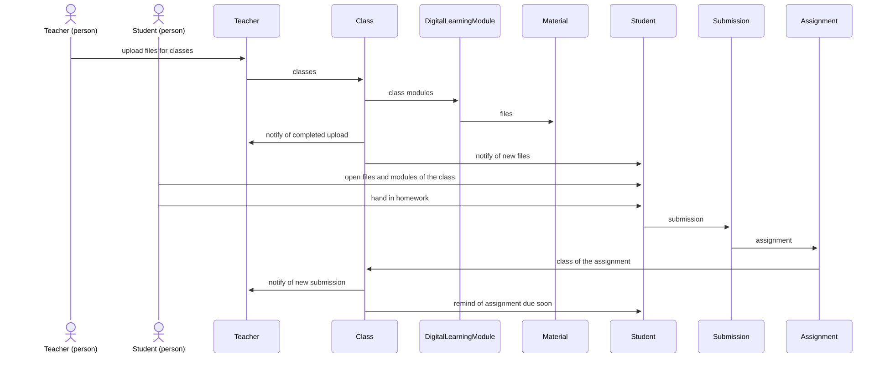](school/sd3_files_homework.svg)

User stories covered

| # | User story |
|---|---|
| 5 | As a student, I want to access files and Digital Learning Module (DLM) in the Learning Management System (LMS) that have been assigned to the class that I participate in, so I am able to work with the material. |
| 8 | As a student, I want to hand my homework to the DLM when they are finished, so that the teacher is able to see my work. |
| 10 | As a student, I want to have access to DLM, so that I can do the work that is expected of me. |
| 11 | As a student, I want to receive a notification when an assignment is due soon and I have not completed it yet, so that I can complete it prior to the due date. |
| 13 | As a student, I want to receive a notification when new files have been made available through the LMS, so that I am always up to date with the uploaded files. |
| 18 | As a teacher I want to receive a notification when a student has uploaded a submission onto the LMs, so that I do not have to manually check to see if a student has submitted work. |
| 32 | As a teacher, I want to receive a confirmation from the LMS system once files have been fully uploaded, so that I do not have to check if any uploads have failed. |
| 44 | As a teacher, I want to upload files to the LMS page of one or multiple classes, so that students can download and access the files. |

### SD4 · Review and grade submissions

A teacher sees a student's answers and progress in a module, grades submissions automatically or by hand, and sees last year's average grade.

[Mermaid source](../../4_gold_standard_sequence_diagrams/school/sd4_grading.mmd) · [SVG image](school/sd4_grading.svg)

[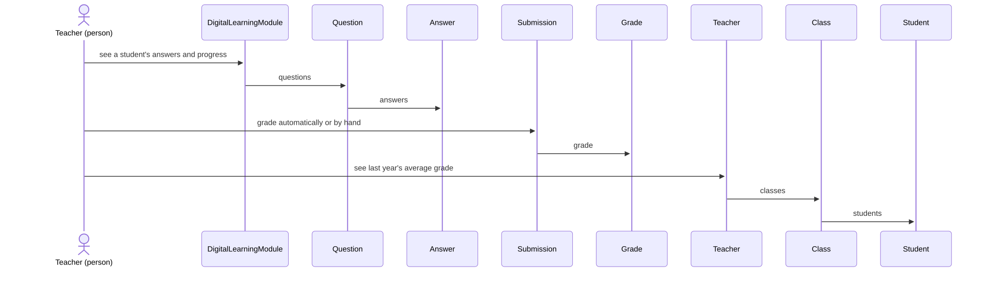](school/sd4_grading.svg)

User stories covered

| # | User story |
|---|---|
| 25 | As a teacher, I want to automatically grade DLM submissions, where possible, when I have submitted all the answers, so that I do not have to manually correct all questions within a DLM. |
| 37 | As a teacher, I want to record grades for a student, so that they can be informed about their performance. |
| 39 | As a teacher, I want to see the answers submitted by individual students within the corresponding DLM, so that I can gain insight into their submissions. |
| 40 | As a teacher, I want to see the average grade that students received last year, starting when they are in their second year, so that I am able to gain insight into the class’ prior performance. |
| 41 | As a teacher, I want to see the progress that an individual student has made within a DLM, so that I can gain insight into their performance. |

### SD5 · Record discipline and behaviour

A teacher records disciplinary actions and behaviour marks for a student, and the mentor is notified when a student is sent out.

[Mermaid source](../../4_gold_standard_sequence_diagrams/school/sd5_discipline_behaviour.mmd) · [SVG image](school/sd5_discipline_behaviour.svg)

[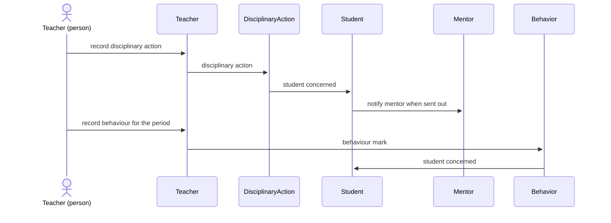](school/sd5_discipline_behaviour.svg)

User stories covered

| # | User story |
|---|---|
| 33 | As a teacher, I want to receive a notification when a student that I mentor is sent out of class, so that I am informed about the behavior of my students. |
| 35 | As a teacher, I want to record disciplinary actions for a student such as: missed homework, no books, or sent out, so that rules that are set about these measures can be policed by administrative staff and that guardians, teachers, and mentors can gain insight. |
| 36 | As a teacher, I want to record either a sufficient or insufficient a student’s behavior every single academic period, so that other users can gain insight into their behavior. |

### SD6 · Record attendance and absences

A guardian reports a child absent and the administrator is notified of the absence form. An administrator registers absences, and a teacher records the attendance of a class.

[Mermaid source](../../4_gold_standard_sequence_diagrams/school/sd6_attendance_absence.mmd) · [SVG image](school/sd6_attendance_absence.svg)

[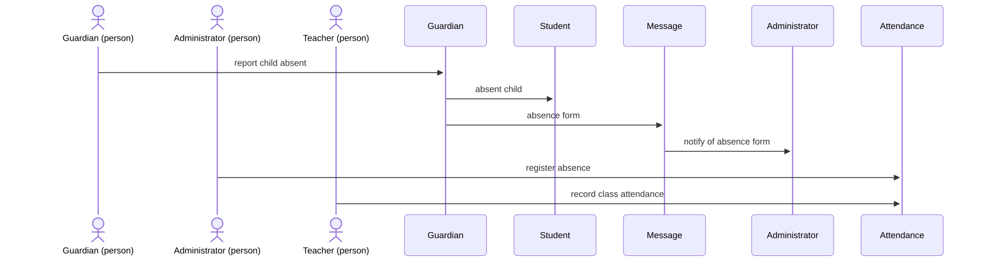](school/sd6_attendance_absence.svg)

User stories covered

| # | User story |
|---|---|
| 2 | As a guardian, I want to fill in an absence of my child, so that administrative staff is aware that my child will not attend school today. |
| 38 | As a teacher, I want to record the attendance of students within my class, so that any students skipping class can be detected. |
| 54 | As an administrator, I want to receive a notification when I receive an absence form, so that I do not have to manually check for new absence forms. |
| 56 | As an administrator, I want to register the absence of a student, teacher, or administrator, so that other users can be notified of their absence. |

### SD7 · View student information and statistics

Teachers, guardians and students view a student's information, adult students control what guardians see, and an administrator views statistics.

[Mermaid source](../../4_gold_standard_sequence_diagrams/school/sd7_student_information.mmd) · [SVG image](school/sd7_student_information.svg)

[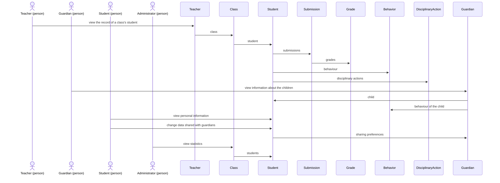](school/sd7_student_information.svg)

User stories covered

| # | User story |
|---|---|
| 4 | As a guardian, I want to view any information related to my children, so that I can gain insight into their behavior and performance. |
| 15 | As a student, I want to view any information related to my account, so that I can gain insight into my performance and behavior. |
| 17 | As a student, once I am 18 years old I want to change my preferences in regard to data being shared with coupled guardians, so that I have a say in what can be accessed by my guardians. |
| 45 | As a teacher, I want to view the attendance, grades that are obtained this year (including behavioral marks), personal details, and disciplinary actions of (any student in my class) or (any student that I am assigned to as mentor), so that I can gain insight into their performance. |
| 52 | As an administrator, I want to make use of various filters and viewpoints, change the view of the visual dashboard to a specific class, year, period, or subject, so that I can gain insight into numerous levels of performance data. |
| 61 | As an administrator, I want to view statistics related to grades, attendance and disciplinary actions that can be mapped over the whole school, so that I am able to gain insight into the performance as a whole. |

### SD8 · Publish and change timetables

An administrator uploads schedules, assigns them to classes and teachers and registers changes. Students view their timetable, and students and teachers are notified of changes.

[Mermaid source](../../4_gold_standard_sequence_diagrams/school/sd8_timetable.mmd) · [SVG image](school/sd8_timetable.svg)

[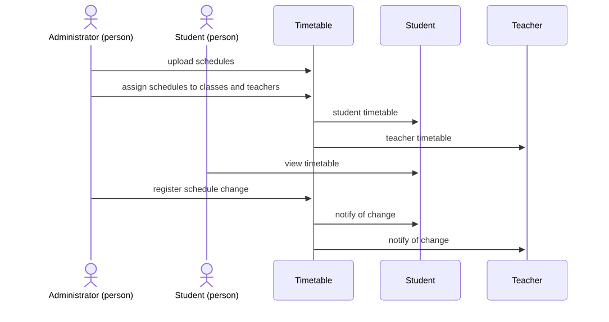](school/sd8_timetable.svg)

User stories covered

| # | User story |
|---|---|
| 9 | As a student, I want to have access to an up-to-date timetable, so that I always know for sure that I am in the correct place at a certain time. |
| 14 | As a student, I want to receive a notification when something changes within my timetable, so that I am notified of any changes in the timetable in a timely manner. |
| 19 | As a teacher I want to receive a notification when something changes within my timetable, so that I am notified of any changes regarding the timetable in a timely manner. |
| 49 | As an administrator, I want to assign schedules to groups of students (classes) or teachers, so that these schedules are accessible by the correct student(s) or teacher. |
| 55 | As an administrator, I want to register any changes to the schedule, so that these are as up-to-date as possible. |
| 59 | As an administrator, I want to upload schedules, so that students and teachers are able to gain insight into their daily schedules. |

### SD9 · See who is in a class

A teacher sees who is in a class on the timetable, and a student sees the contact information of classmates.

[Mermaid source](../../4_gold_standard_sequence_diagrams/school/sd9_class_members.mmd) · [SVG image](school/sd9_class_members.svg)

[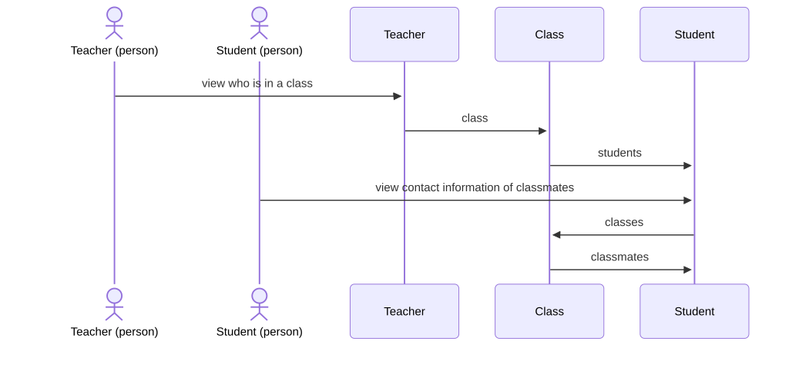](school/sd9_class_members.svg)

User stories covered

| # | User story |
|---|---|
| 16 | As a student, I want to view the contact information of students attending my classes, so that collaboration is made possible. |
| 46 | As a teacher, I want to view who is in a specific class that is mentioned in my timetable, so that I can gain insight into whom can be expected to attend the class. |

## Sports

7 diagrams, 60 messages, 61 of 63 user stories covered (not covered: 48, 50), 12 of 12 gold associations used. [User stories](../../1_user_stories/sports.txt) · [Domain model](../sports.svg)

### SD1 · Sign up and subscribe

A customer opens an account, adds personal and banking details, chooses a membership type, and later extends the subscription or unsubscribes.

[Mermaid source](../../4_gold_standard_sequence_diagrams/sports/sd1_sign_up.mmd) · [SVG image](sports/sd1_sign_up.svg)

User stories covered

| # | User story |
|---|---|
| 1 | As a new Customer, I want to open an account in the system, so I can start training at Daily Sports. |
| 2 | As a Customer, I want to add my personal information, so I meet the requirements of the gym for signing up. |
| 3 | As a Customer, I want to add my banking details, so I can pay for my subscription. |
| 4 | As a Customer, I want to be able to choose my membership type, so I can pay according to my wishes. |
| 5 | As a Customer, I want to be able to extend my subscription for Daily Sports, so I can continue working out. |
| 6 | As a Customer, I want to know how long my subscription lasts, so I know when I need to extend it. |
| 7 | As a Returning Customer, I want to be able to use my previous information, so that sign-up is easier. |
| 8 | As a Customer, I want to be able to unsubscribe. |

### SD2 · Manage account and family membership

A customer views and changes personal, payment and notification settings, and manages the persons on a family membership.

[Mermaid source](../../4_gold_standard_sequence_diagrams/sports/sd2_manage_account.mmd) · [SVG image](sports/sd2_manage_account.svg)

[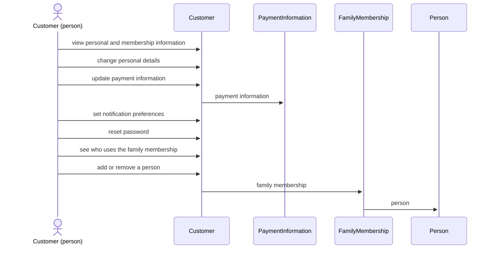](sports/sd2_manage_account.svg)

User stories covered

| # | User story |
|---|---|
| 9 | As a Customer, I want to be able to reset my password. |
| 10 | As a Customer, I  want  to  be  able  to  change  my personal details. |
| 11 | As a Customer, I want to be able to update my payment information. |
| 12 | As a Customer with a Family Membership, I want to see who is using my membership. |
| 13 | As a Customer with a Family Membership, I want to add a person to my membership, so that I can utilize it effectively. |
| 14 | As a Customer with a Family Membership, I want to remove a person from my membership. |
| 51 | As a Customer, I want to receive notifications by the method which I prefer, so that I am able to see them and not be annoyed by them. |
| 52 | As a Customer, I want to receive notifications by email. |
| 53 | As a Customer, I want to receive push notifications from the system. |
| 54 | As a Customer, I want to choose what to receive notifications for. |
| 58 | As a Customer, I want to see an overview of my personal information. |
| 59 | As a Customer, I want to see information about my membership. |

### SD3 · Plan lessons

An admin adds and removes trainers. A trainer checks free rooms, adds a lesson with its details to the schedule, and views the own schedule and training sessions.

[Mermaid source](../../4_gold_standard_sequence_diagrams/sports/sd3_plan_lessons.mmd) · [SVG image](sports/sd3_plan_lessons.svg)

[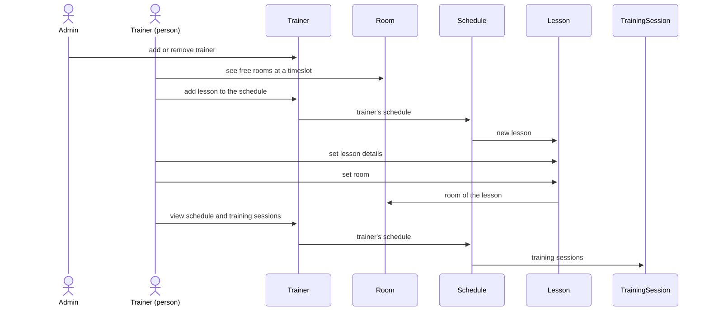](sports/sd3_plan_lessons.svg)

User stories covered

| # | User story |
|---|---|
| 25 | As a Trainer, I want to see which rooms are free at a given timeslot, so I can organize a lesson. |
| 26 | As a Trainer, I want to add a lesson to the schedule, so customers would be able to sign-up. |
| 27 | As a Trainer, I want to set the time of the lesson, so the customers know when they should be at Daily Sports. |
| 28 | As a Trainer, I want to set the description of the lesson, so the customers know what to expect from it. |
| 29 | As a Trainer, I want to set the room of the lesson, so the customers know where to go. |
| 30 | As a Trainer, I want to set the type of lesson. |
| 31 | As a Trainer, I want to set the maximum number of people allowed in the lesson, so that we don’t over-crowd a room. |
| 32 | As a Trainer, I want to be able to see what my schedule is. |
| 47 | As an Admin I want to add a new trainer to the system, so the new trainer can start working. |
| 49 | As an Admin I want to remove a trainer from the system, so they cannot access the system anymore. |
| 60 | As a Trainer, I want to see information about my past and future training sessions. |

### SD4 · Change and cancel lessons

Trainers edit and cancel their own lessons, admins any lesson or training session. Customers are notified of a cancellation and confirm that they are aware of it.

[Mermaid source](../../4_gold_standard_sequence_diagrams/sports/sd4_change_cancel_lessons.mmd) · [SVG image](sports/sd4_change_cancel_lessons.svg)

[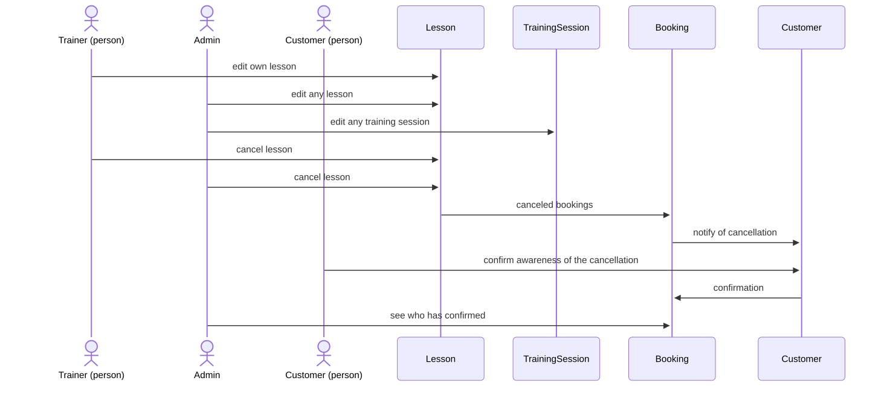](sports/sd4_change_cancel_lessons.svg)

User stories covered

| # | User story |
|---|---|
| 20 | As an Admin, I want to be able to edit all personal training sessions. |
| 33 | As a Trainer, I want to be the only Trainer who can edit my lessons. |
| 34 | As a Trainer, I want to edit the time of the lesson, so a more suitable time can be set. |
| 35 | As a Trainer, I want to change the room of the lesson, so I can move the lesson to another place. |
| 36 | As a Trainer, I want to edit the description of the lesson, so the customers know what to expect. |
| 37 | As a Trainer, I want to edit the maximum number of people allowed in the lesson, so it is correct for this lesson. |
| 38 | As an Admin, I want to be able to edit any lesson. |
| 39 | As a Trainer, I want to cancel a lesson, so customers won’t show up in an empty room when I can’t make it. |
| 40 | As an Admin, I want to cancel a lesson, so customers won’t show up in an empty room when the Trainer can’t make it. |
| 41 | As a Customer, I want to receive a notification when my booked lesson is canceled, so I won’t  go to Daily Sports for a canceled  lesson. |
| 55 | As a Customer, I want to receive a notification when a training session is canceled. |
| 56 | As a Customer, I want to confirm that I am aware that my booking has been canceled. |
| 57 | As an Admin, I want to know which customers are aware that their booking has been canceled, so that I can call them if they aren’t. |

### SD5 · Book lessons and training sessions

A customer views available lessons and books one, books or cancels lessons and training sessions by calling the gym, and views future and past bookings.

[Mermaid source](../../4_gold_standard_sequence_diagrams/sports/sd5_book_lessons.mmd) · [SVG image](sports/sd5_book_lessons.svg)

[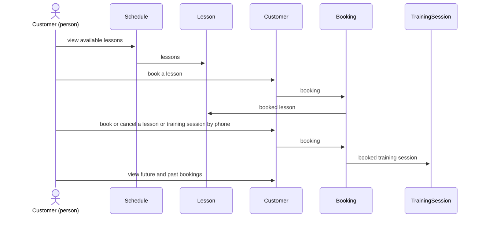](sports/sd5_book_lessons.svg)

User stories covered

| # | User story |
|---|---|
| 15 | As a Customer, I want to see an overview of all available lessons, so that I can choose which one to book. |
| 16 | As a Customer, I want to see what future lessons I have booked, so that I can manage my time. |
| 17 | As a Customer, I want to see a record of previous lessons I have booked, so I can track my progress. |
| 18 | As a Customer, I want to be able to call the gym to book a lesson, so that I don’t have to use the application. |
| 19 | As a Customer, I want to be able to call the gym to cancel a lesson, so that I don’t have to use the application. |
| 21 | As a Customer, I want to call the gym to book a personal training session, so that I don’t have to use the application. |
| 22 | As a Customer, I want to call the gym to cancel a personal training session, so that I don’t have to use the application. |

### SD6 · Use the free practice area and check in

A customer books a spot in the free practice area and sees the booked spots per timeslot. At check-in an admin sees the customer's subscription and bookings.

[Mermaid source](../../4_gold_standard_sequence_diagrams/sports/sd6_free_practice_check_in.mmd) · [SVG image](sports/sd6_free_practice_check_in.svg)

[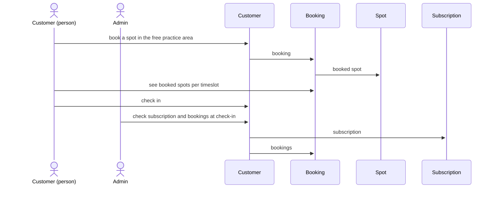](sports/sd6_free_practice_check_in.svg)

User stories covered

| # | User story |
|---|---|
| 23 | As a Customer, I want to be able to book a spot for the free practice area, so that I know it will have capacity for me when I arrive. |
| 24 | As a Customer, I want to see how many spots have been booked for a given timeslot. |
| 61 | As a Customer, I want to have a method by which I can check-in. |
| 62 | As an Admin, I want to see if the Customer who is checking-in has a subscription. |
| 63 | As an Admin, I want to see if the Customer who is checking-in has any bookings. |

### SD7 · Handle no-shows

An admin sees missed bookings and how often a customer did not show up. The customer is notified, and repeated no-shows are fined.

[Mermaid source](../../4_gold_standard_sequence_diagrams/sports/sd7_no_shows.mmd) · [SVG image](sports/sd7_no_shows.svg)

[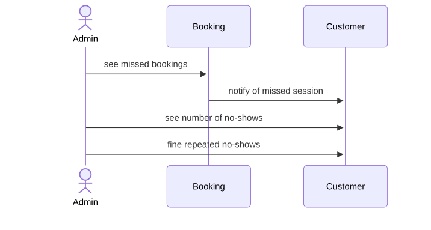](sports/sd7_no_shows.svg)

User stories covered

| # | User story |
|---|---|
| 42 | As a Customer, I want to be notified if I didn’t go to a session I had booked, so that I know it happened. |
| 43 | As an Admin, I want to see if a customer did not show up for a session they had booked, so that I can take further action. |
| 44 | As an Admin, I want to see how many times a customer did not show up for a session. |
| 45 | As an Admin, I want to have the system to issue a fine if a customer does not show up more than 2 times, so that we can deter no-shows. |
| 46 | As an Admin, I want to have the fines for repeat offenders to increase exponentially for each subsequent offense, so we can deter no-shows. |

## Supermarket

7 diagrams, 57 messages, 50 of 51 user stories covered (not covered: 15), 16 of 16 gold associations used. [User stories](../../1_user_stories/supermarket.txt) · [Domain model](../supermarket.svg)

### SD1 · Manage account and settings

A customer creates an account, manages newsletter and push notifications, links a loyalty card and adjusts the display settings.

[Mermaid source](../../4_gold_standard_sequence_diagrams/supermarket/sd1_account_settings.mmd) · [SVG image](supermarket/sd1_account_settings.svg)

[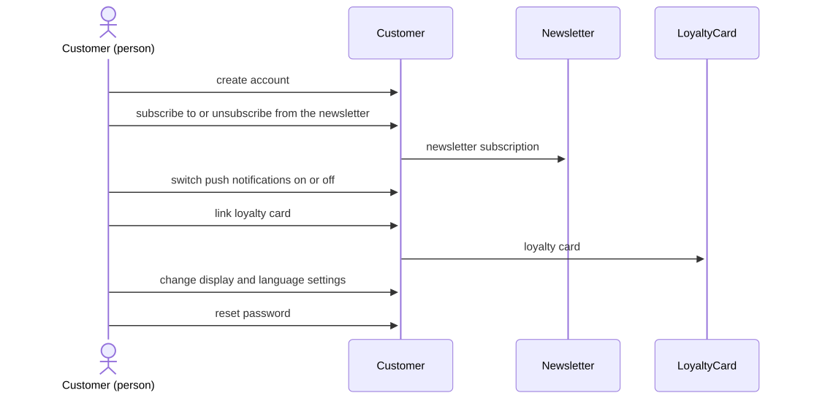](supermarket/sd1_account_settings.svg)

User stories covered

| # | User story |
|---|---|
| 1 | As a customer, I want to create a personal account. |
| 2 | As a customer, I want to be able to sign up for the newsletter, so that I am aware of discounts and anomalies. |
| 3 | As a customer, I want to be able to unsubscribe from the newsletter, so that I no longer receive the newsletter. |
| 4 | As a customer, I want to activate push notifications, so that I am aware of discounts and anomalies. |
| 5 | As a customer, I want to be able to deactivate push notifications, so that I no longer receive push notifications. |
| 6 | As a customer, I want to reset my password. |
| 7 | As a customer, I want to change the font size of the text, so that it is easier for me to read. |
| 8 | As a customer, I want to change the contrast between the text and the background, so that it is easier for me to read. |
| 9 | As a customer, I want to change the application’s language to my native language, so that it is easier for me to understand the app. |
| 44 | As a customer, I want to link my existing loyalty card, so that I do not have to physically have it. |

### SD2 · Find products and check stock

A customer searches, filters and sorts products, reads product information, and checks stock, location and availability in stores.

[Mermaid source](../../4_gold_standard_sequence_diagrams/supermarket/sd2_find_products.mmd) · [SVG image](supermarket/sd2_find_products.svg)

[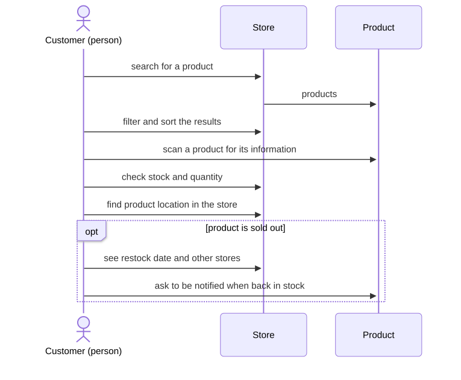](supermarket/sd2_find_products.svg)

User stories covered

| # | User story |
|---|---|
| 18 | As a customer, I want to search for a product, so that I know if it is in the supermarket's stock. |
| 19 | As a customer, I want to filter products on dietary restrictions, so that I know which products are suited for my diet. |
| 20 | As a customer, I want to order products by price in ascending order, so that I can save money. |
| 21 | As a customer, I want to order products by popularity, so that I become aware of which products are liked by most people. |
| 23 | As a customer, I want to scan the barcode of an item, so that I can see the product information without searching for it online. |
| 24 | As a customer, I want to read the product information, so that I find it easier than reading the product's packaging. |
| 25 | As a customer, I want to see if the product I need is in stock, so that I do not end up going to the store for a product that is sold out. |
| 26 | As a customer, I want to be notified when an item I need is back in stock, so that I do not miss out on it. |
| 27 | As a customer, I want to be able to see if a product that is sold out in my store is available in another store, so that I can purchase the product there. |
| 28 | As a customer, I want to see the available quantity of a product in store, so that I know that there is enough to fulfill my needs. |
| 29 | As a customer, I want to see when a product will be available again when it is currently sold out, so that I know when I can buy it again. |
| 41 | As a customer, I want to find the location of products in a specific store, so that my shopping becomes easier and faster. |

### SD3 · Shop in a store

A customer gets the nearest store recommended, changes the default store, scans products into the shopping list and adds products to the wishlist.

[Mermaid source](../../4_gold_standard_sequence_diagrams/supermarket/sd3_shop_in_store.mmd) · [SVG image](supermarket/sd3_shop_in_store.svg)

[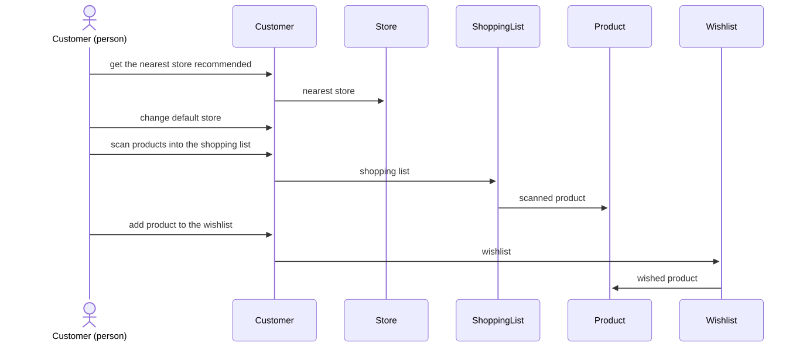](supermarket/sd3_shop_in_store.svg)

User stories covered

| # | User story |
|---|---|
| 16 | As a customer, I want to scan products in the store to build my shopping list, so that I do not have to scan my products again at checkout. |
| 17 | As a customer, I want to be able to add products to my wishlist, so that I can easily find them in the app. |
| 42 | As a customer, I want to get recommendation regarding the nearest store, so that I won’t be need to select the related store. |
| 43 | As a customer, I want to be able to change the selection of my default store, so that I can easily order groceries at a different location. |

### SD4 · Receive discounts and suggestions

An employee edits product discounts, and a customer is notified of a personal discount on frequently bought products. The customer turns on sale notifications and receives product suggestions.

[Mermaid source](../../4_gold_standard_sequence_diagrams/supermarket/sd4_discounts_suggestions.mmd) · [SVG image](supermarket/sd4_discounts_suggestions.svg)

[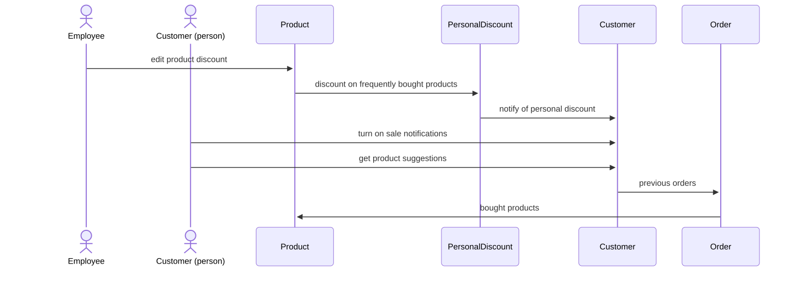](supermarket/sd4_discounts_suggestions.svg)

User stories covered

| # | User story |
|---|---|
| 10 | As a customer, I want to receive suggestions on products that I might like, so that I can find my new favorite products. |
| 11 | As a customer, I want to receive a special personal discount on the products that I frequently buy, so that I can save money. |
| 12 | As a customer, I want to be notified of special personal discounts, so that I do not miss out on them. |
| 22 | As a customer, I want to be notified of what products are on sale, so that I can save money. |
| 46 | As an employee, I want to edit the discounts for a specific product, so that customers are provided with up-to-date information. |

### SD5 · Get recipe ideas

An employee adds recipes. A customer browses recipe ideas, gets recipes for liked products and sees the products a recipe uses.

[Mermaid source](../../4_gold_standard_sequence_diagrams/supermarket/sd5_recipes.mmd) · [SVG image](supermarket/sd5_recipes.svg)

[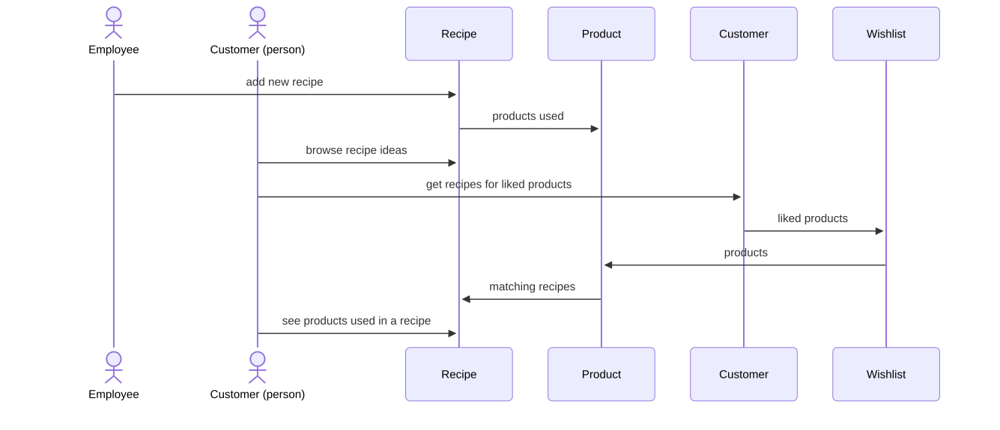](supermarket/sd5_recipes.svg)

User stories covered

| # | User story |
|---|---|
| 14 | As a customer, I want to get recipes based on products I like, so I can potentially discover new meals to cook. |
| 30 | As a customer, I want to be provided with recipe ideas, so that I gain inspiration for my meals. |
| 31 | As a customer, I want to see which products were used in a recipe, so that I know which products to buy when I am making a recipe. |
| 45 | As an employee, I want to update the application with new recipes, so that I can provide customers with inspiration for cooking a meal. |

### SD6 · Order groceries online

A customer purchases products online, reuses previous orders from the order history and pays digitally.

[Mermaid source](../../4_gold_standard_sequence_diagrams/supermarket/sd6_order_online.mmd) · [SVG image](supermarket/sd6_order_online.svg)

User stories covered

| # | User story |
|---|---|
| 32 | As a customer, I want to purchase products online, so that I do not have to find the products in the store myself. |
| 37 | As a customer, I want to see my order history, so that I can easily find products that I have purchased before. |
| 38 | As a customer, I want to be able to place a previous order again, so that I do not have to add the products to my shopping cart again. |
| 39 | As a customer, I want to add products from the overview of my previous order to my new order, so that I can save time adding products to my order. |
| 40 | As a customer, I want to be able to digitally pay for my delivered groceries, so that I am not required to pay in person. |

### SD7 · Deliver the groceries

A customer has groceries delivered at a chosen time, by express or by subscription. An employee confirms the delivery time and informs the customer about problems.

[Mermaid source](../../4_gold_standard_sequence_diagrams/supermarket/sd7_delivery.mmd) · [SVG image](supermarket/sd7_delivery.svg)

[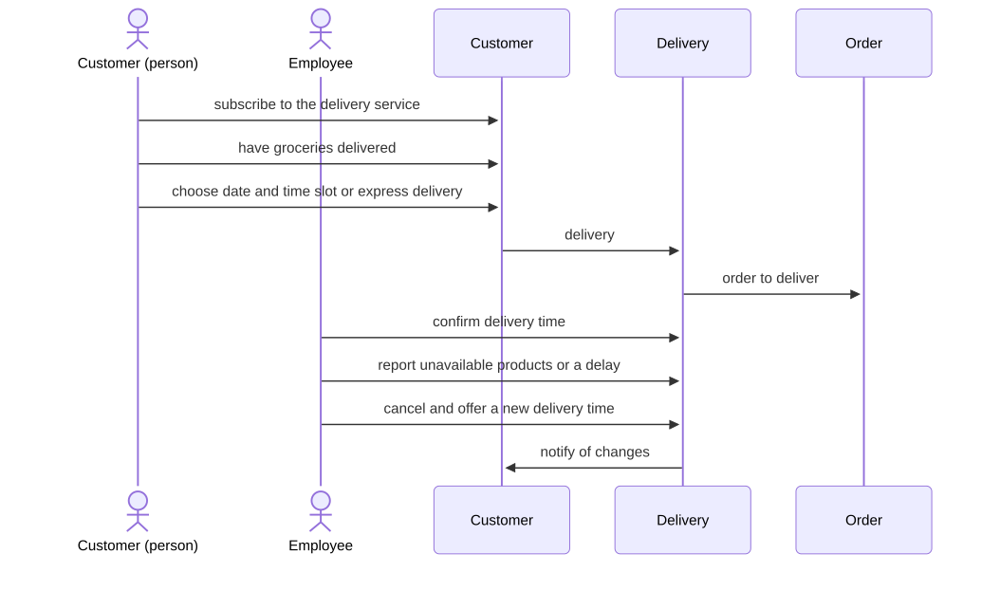](supermarket/sd7_delivery.svg)

User stories covered

| # | User story |
|---|---|
| 13 | As a customer, I want to have a subscription-based delivery service, so that I gain discounts in case of frequent deliveries. |
| 33 | As a customer, I want to have my groceries delivered to me, so that I do not have to go to the store myself. |
| 34 | As a customer, I want to be able to select the date on which my groceries will be delivered, so that I am sure that I have them in time. |
| 35 | As a customer, I want to be able to select a time slot for the delivery of my groceries so that I can make sure that I am home to receive the delivery. |
| 36 | As a customer, I want to have my groceries delivered using an express delivery service, so that I can have products delivered to me when I need them quickly. |
| 47 | As an employee, I want to confirm an established delivery time, so that customers are accurately informed on when their groceries will arrive. |
| 48 | As an employee, I want to notify customers of suddenly unavailable products in their delivery, so that customers can manage their expectations accordingly. |
| 49 | As an employee, I want to notify customers in case of a delayed delivery, so that customers do not have to unnecessarily wait longer than needed. |
| 50 | As an employee, I want to contact the customer in case of a canceled delivery so that customers are given full transparency, and their delivery is handled adequately later. |
| 51 | As an employee, I want to provide the customer with a new delivery time in case of a canceled delivery, so that the customer remains in control of when their groceries will arrive. |

## Ticket

7 diagrams, 51 messages, 51 of 54 user stories covered (not covered: 18, 27, 40), 13 of 13 gold associations used. [User stories](../../1_user_stories/ticket.txt) · [Domain model](../ticket.svg)

### SD1 · Manage profile and preferences

A user saves personal and payment details, states preferred genres and event types, and keeps the profile up to date.

[Mermaid source](../../4_gold_standard_sequence_diagrams/ticket/sd1_profile.mmd) · [SVG image](ticket/sd1_profile.svg)

User stories covered

| # | User story |
|---|---|
| 1 | As a user, I want to save my personal information (i.e., name, date of birth, email, address, and preferences) so that I don't have to repeat this process with every ticket purchase. |
| 2 | As a user, I want to save my payment details so that I don't have to fill these details in every time. |
| 3 | As a user, I want to fill out a short survey about my preferences in (music) genre and event types so that I can receive personalized content. |
| 5 | As a user, I want to see and edit my preferences so that my information does not become outdated. |
| 6 | As a user, I want to be able to change my password so that I can keep my account information safe. |
| 7 | As a user, I want to be able to edit my personal information (e.g., address) so that I can update it when needed. |

### SD2 · Discover events on the homepage

A visitor sees popular upcoming events and a calendar view and opens an event page. A registered user gets events recommended from their profile.

[Mermaid source](../../4_gold_standard_sequence_diagrams/ticket/sd2_homepage.mmd) · [SVG image](ticket/sd2_homepage.svg)

User stories covered

| # | User story |
|---|---|
| 4 | As a user, I want to see personalized content (e.g., recommended events) based on my user profile to quickly see events I am interested in. |
| 46 | As a visitor, I want to see upcoming events in a calendar-type view so that I can compare it to my own planner. |
| 47 | As a visitor, I want to see popular, upcoming events so that I can stay updated about interesting events. |
| 48 | As a visitor, I want to click on an event shown on the homepage and be directed to the event page, so that I don't have to search for it. |

### SD3 · Search for events

A visitor searches for events with available tickets, filters by venue, genre and price, sorts by date and opens a result.

[Mermaid source](../../4_gold_standard_sequence_diagrams/ticket/sd3_search.mmd) · [SVG image](ticket/sd3_search.svg)

User stories covered

| # | User story |
|---|---|
| 19 | As a visitor, I want to see events with available tickets so that I can buy the tickets. |
| 28 | As a visitor, I want to get a list of events as search results, so that I can select the desired event. |
| 29 | As a visitor, I want to be able to land on the event page when clicking on a search result so that I can visit the page I want. |
| 30 | As a visitor, I want to have the search engine non-case sensitive and punctuation sensitive so that I can still find the desired event when I misspell the name. |
| 31 | As a visitor, I want to be able to sort my search results by date so that I can see which events are up first. |
| 32 | As a visitor, I want to be able to filter my search by price so that I can only see tickets within my price range. |
| 33 | As a visitor, I want to be able to filter my search results by venue, so that I can easily find the event I want to go to. |
| 34 | As a visitor, I want to be able to filter a list of events by genre, so that I don't have to see events I'm not interested in. |

### SD4 · Event page and favorites

An artist provides a description and links for the event page, a visitor reads the page, and a user favorites events and artists.

[Mermaid source](../../4_gold_standard_sequence_diagrams/ticket/sd4_event_page.mmd) · [SVG image](ticket/sd4_event_page.svg)

User stories covered

| # | User story |
|---|---|
| 10 | As a user, I want to find my list of favorited artists and events under my profile, so that I can easily find them back. |
| 11 | As a visitor, I want to read about the event (e.g., location, date, and artist information), so that I can decide whether to buy a ticket. |
| 49 | As an artist, I want to find information about my events on the designated event page so that visitors can read about my event and consider buying tickets. |
| 50 | As an artist, I want to have a link to my website on the event page so that fans can find out more about me. |
| 51 | As an artist, I want to have a link to my social media on the event page, so that fans can follow me for regular updates. |
| 52 | As an artist, I want to have a description of myself and my upcoming event (or tour) to be shown on my event page so that visitors can inform themselves about my show. |
| 53 | As a user, I want to favorite events or artists on the related event page, so that I can easily find it back. |
| 54 | As an artist, I want to have a link to music platforms (e.g., YouTube, Spotify, Apple Music), so that visitors buying tickets for my show can stream my music. |

### SD5 · Buy tickets

A visitor chooses ticket types and seats on the event page, puts tickets in the cart, checks out as a user or as a guest, and pays.

[Mermaid source](../../4_gold_standard_sequence_diagrams/ticket/sd5_buy_tickets.mmd) · [SVG image](ticket/sd5_buy_tickets.svg)

User stories covered

| # | User story |
|---|---|
| 12 | As a visitor, I want to be able to buy tickets directly from the event page, so that the purchasing process is shortened. |
| 14 | As a (single-time) visitor, I want to buy a ticket as a guest, so that the overall purchase progress is shorter. |
| 15 | As a guest (i.e., single-time user), I want to only fill in my name and email when buying a ticket so that the process is faster than creating an account. |
| 16 | As a guest, I want to not fill in all my information to buy a ticket, so that I can avoid unnecessarily sharing my personal data. |
| 17 | As a guest, I can use the platform the same way as users looking to buy a ticket, so that I am not forced into registering. |
| 20 | As a visitor, I want to be able to buy multiple tickets for one event in one purchase so that I can buy tickets for me and whomever I go with. |
| 21 | As a visitor, I want to see available seats at the event, so that I can decide which one to buy. |
| 22 | As a visitor, I want to see the available seats in a map of the venue so that I can pick the right seating place for during the event. |
| 23 | As a visitor, I want to see the types of tickets (e.g., normal, premium, gold tickets) once I select the event, so that I can choose which type I want to buy. |
| 24 | As a visitor, I want to add tickets to the shopping cart, so that I can buy tickets. |
| 25 | As a visitor, I want to see my order summary, so that I can make sure that I buy the correct ticket(s). |
| 26 | As a visitor, I want to see a list of payment methods. so that I can pay for my tickets. |

### SD6 · Resell a ticket

A reseller saves bank account details, uploads a digital ticket from the event page and offers it at a price. The ticket is validated against its event, and a service fee is kept.

[Mermaid source](../../4_gold_standard_sequence_diagrams/ticket/sd6_resell_ticket.mmd) · [SVG image](ticket/sd6_resell_ticket.svg)

User stories covered

| # | User story |
|---|---|
| 13 | As a reseller, I want to be able to sell my tickets directly from the event page, so that the reselling process is shortened. |
| 35 | As a company, I want to have the minimum price for reselling a ticket at 5 cents so that I can receive a service fee. |
| 36 | As a company, I want to have resellers sell only digital tickets, so that the tickets can be validated automatically. |
| 37 | As a company, I want to validate tickets, so that I can ensure visitors a trustworthy platform. |
| 38 | As a company, I want to deduct a service fee of 3% from the total price set by the reseller so that the reselling platform is a financially beneficial addition to the business. |
| 39 | As a company, I want to avoid fraudulent behavior on the reselling platform, so that visitors gain trust in the platform. |
| 41 | As a reseller, I want to be able to resell tickets directly from the event page so that the reselling process is shortened. |
| 42 | As a reseller, I can upload my digital ticket from my local device, so that I can offer it to other users. |
| 43 | As a reseller, I can set any price above 5 cents for the ticket I'm selling. |
| 44 | As a reseller, I can add a short description of the event so that the other (buying) users know what type of ticket, and for which event, I'm selling. |
| 45 | As a reseller, I want to save my bank account (IBAN number) in my user profile, so that I can receive the money for the tickets directly to my bank account. |

### SD7 · View orders and upcoming events

A user views previous ticket orders and the upcoming events for which tickets were bought.

[Mermaid source](../../4_gold_standard_sequence_diagrams/ticket/sd7_orders.mmd) · [SVG image](ticket/sd7_orders.svg)

User stories covered

| # | User story |
|---|---|
| 8 | As a user, I want to see a history of previous ticket orders, so that I can easily retrieve tickets and additional information when needed. |
| 9 | As a user, I want to see an overview of upcoming events for which I bought a ticket, so that I can easily find this information when needed. |

