# Sequence-diagram gallery

[Back to dataset README](../../README.md) · [Conventions and coverage](../../4_gold_standard_sequence_diagrams/README.md)

Gold-standard sequence diagrams, rendered from the Mermaid sources in `4_gold_standard_sequence_diagrams/`. They are an addition to the original dataset, written for a master thesis on validating LLM-generated domain models, and are not part of the work of Bragilovski et al. Click an image to open its SVG and zoom in. `[n]` in a diagram is the line number of the user story it covers.

## Planningpoker

7 diagrams, 58 messages, 33 of 53 user stories covered (not covered: 21–26, 37–38, 42–53). [User stories](../../1_user_stories/planningpoker.txt) · [Domain model](../planningpoker.svg)

### SD1 · Set up a game

The moderator creates a game, chooses the card deck and gets the invitation URL to share with the estimators.

[Mermaid source](../../4_gold_standard_sequence_diagrams/planningpoker/sd1_set_up_game.mmd) · [SVG image](planningpoker/sd1_set_up_game.svg)

[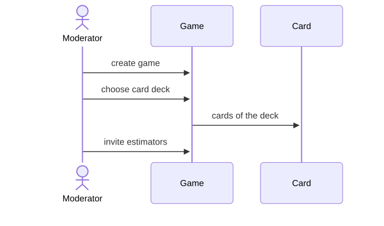](planningpoker/sd1_set_up_game.svg)

User stories covered

| # | User story |
|---|---|
| 1 | As a moderator, I want to create a new game by entering a name and an optional description, so that I can start inviting estimators. |
| 2 | As a moderator, I want to invite estimators by giving them a URL where they can access the game, so that we can start the game. |
| 27 | As a moderator, I want to select whether to have the team estimate with {0, 1/2, 1, 2, 3, 5, 8, etc.} or {0, 1, 2, 4, 8, 16, 32, etc.}, so that the team can use either the modified Fibonacci sequence or powers of 2. |
| 28 | As a moderator, I want to invite up to 15 estimators, so that we can play with large but not immense teams. |

### SD2 · Join a game

An estimator opens the invitation URL and joins with a name, unless 15 estimators have already joined.

[Mermaid source](../../4_gold_standard_sequence_diagrams/planningpoker/sd2_join_game.mmd) · [SVG image](planningpoker/sd2_join_game.svg)

[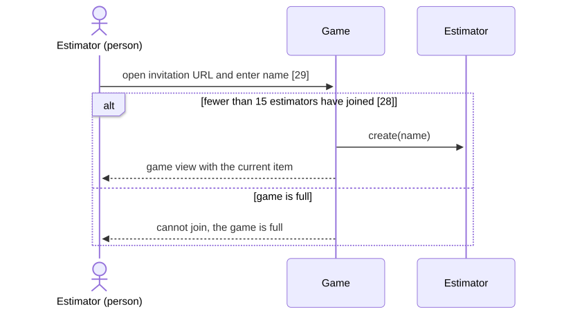](planningpoker/sd2_join_game.svg)

User stories covered

| # | User story |
|---|---|
| 28 | As a moderator, I want to invite up to 15 estimators, so that we can play with large but not immense teams. |
| 29 | As an estimator, I want to join a game by entering my name on the page I received the URL for, so that I can participate. |

### SD3 · Prepare and maintain the items

The moderator starts a round with a first item, can import more items from a spreadsheet, and adds, edits or deletes items during play; everyone sees the round's items.

[Mermaid source](../../4_gold_standard_sequence_diagrams/planningpoker/sd3_manage_items.mmd) · [SVG image](planningpoker/sd3_manage_items.svg)

[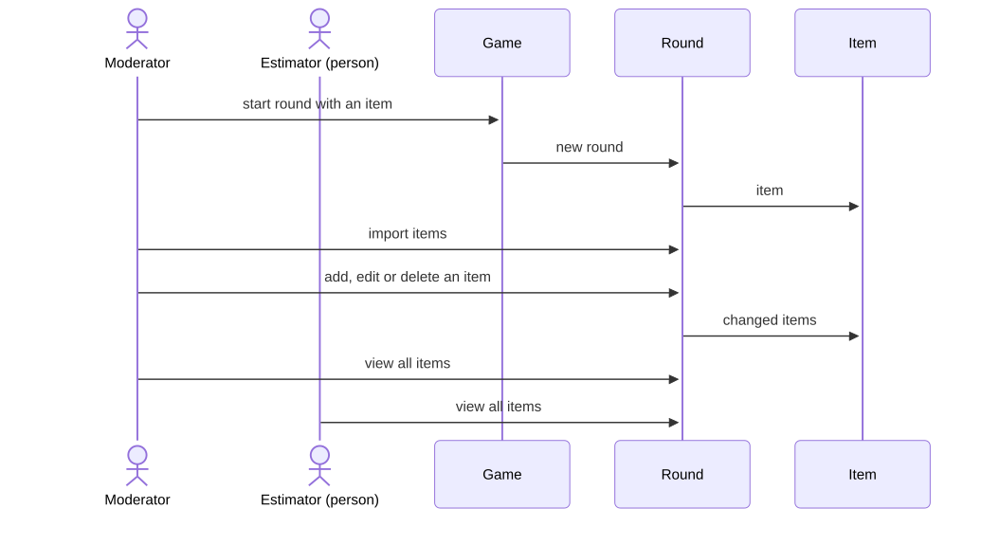](planningpoker/sd3_manage_items.svg)

User stories covered

| # | User story |
|---|---|
| 3 | As a moderator, I want to start a round by entering an item in a single multi-line text field, so that we can estimate it. |
| 4 | As a moderator, I want to see all items we try to estimate this round, so that I can answer questions about the current item such as "does this include ___". |
| 6 | As a moderator, I want to add an item to the list of items to be estimated, so that so that we can be flexible and accommodate situations where we think of a new item while playing. |
| 7 | As a moderator, I want to edit an item in the list of items to be estimated, so that I can make it better reflect the team's understanding of the item. |
| 8 | As a moderator, I want to delete an item from the list of items to be estimated, so that we can remove it and not estimate it. |
| 14 | As a moderator, I want to import items from a spreadsheet, so that I don't have to copy and paste each individual item. |
| 15 | As a moderator, I want to copy/paste items from a spreadsheet, so that I can get started more quickly. |
| 31 | As an estimator, I want to see all items we will try to estimate this round, so that I have a feel for the sizes of the various items. |

### SD4 · Estimate an item

The moderator selects an item; each estimator plays a card, which they can change until the estimates are shown.

[Mermaid source](../../4_gold_standard_sequence_diagrams/planningpoker/sd4_estimate_item.mmd) · [SVG image](planningpoker/sd4_estimate_item.svg)

[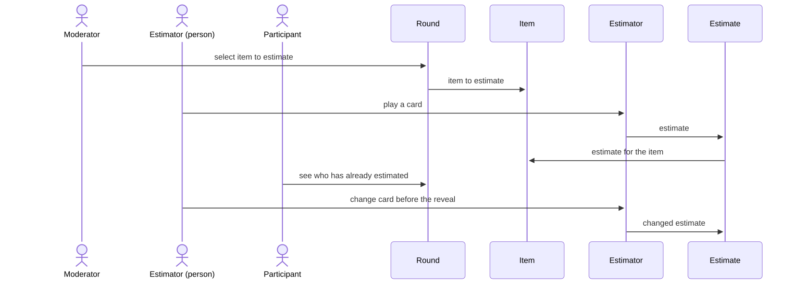](planningpoker/sd4_estimate_item.svg)

User stories covered

| # | User story |
|---|---|
| 5 | As a moderator, I want to select an item to be estimated or re-estimated, so that the team sees that item and can estimate it. |
| 30 | As an estimator, I want to see the item we’re estimating, so that I know what I’m giving an estimate for. |
| 32 | As a participant, I want to immediately see that an estimate has been given by a specific estimator, so that I know who has already given an estimate and who we’re still waiting for. |
| 34 | As a participant, I want to be able to change my estimate up until the last person selects a card and all are shown, so that I can change my mind based on information I hear. |
| 40 | As a participant, I want to always have the cards in the same order across multiple draws, so that it's easy to compare estimates. |
| 41 | As a participant, I want to change my estimate as long as the draw has not been completed, so that I can change my mind. |

### SD5 · Reveal and accept the estimates

The estimates are shown to everyone at once, early if the moderator decides so; the moderator then accepts the average or the agreed estimate.

[Mermaid source](../../4_gold_standard_sequence_diagrams/planningpoker/sd5_reveal_accept.mmd) · [SVG image](planningpoker/sd5_reveal_accept.svg)

[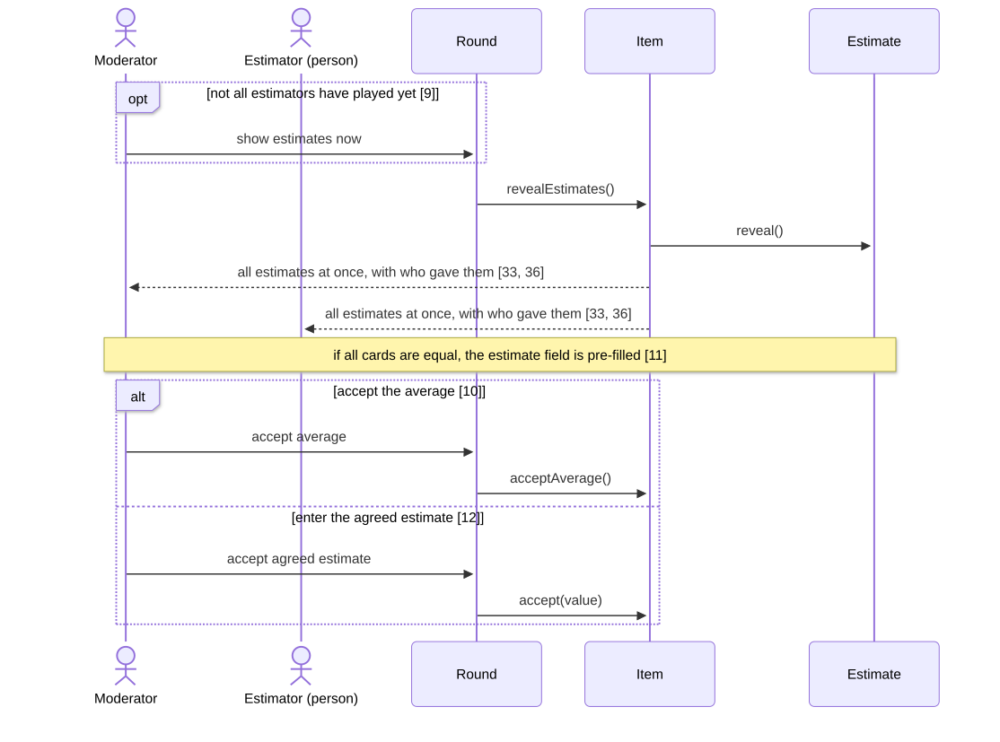](planningpoker/sd5_reveal_accept.svg)

User stories covered

| # | User story |
|---|---|
| 9 | As a moderator, I want to show all estimates immediately, so that I can decide to show the estimates that have been given even though not all estimators have given their estimate. |
| 10 | As a moderator, I want to accept the average of all estimates, so that we can move on to the next item when we agree. |
| 11 | As a moderator, I want to have the "estimate" field filled in automatically if all estimators show the same card, so that I can accept it more quickly. |
| 12 | As a moderator, I want to enter the agreed-upon estimate, so that we can move on to the next item when we agree. |
| 33 | As a participant, I want to be shown all estimates at the same time after all estimators have given their estimate, so that I can be sure estimates are independent and not influenced by other estimates given in the same draw. |
| 36 | As a participant, I want to see who gave what estimates during the current round, so that I know this when we’re discussing the estimates. |

### SD6 · Look back and re-estimate

A participant scrolls back through earlier rounds; the moderator reopens an earlier item and everyone sees each estimator's prior estimates before estimating again.

[Mermaid source](../../4_gold_standard_sequence_diagrams/planningpoker/sd6_look_back.mmd) · [SVG image](planningpoker/sd6_look_back.svg)

[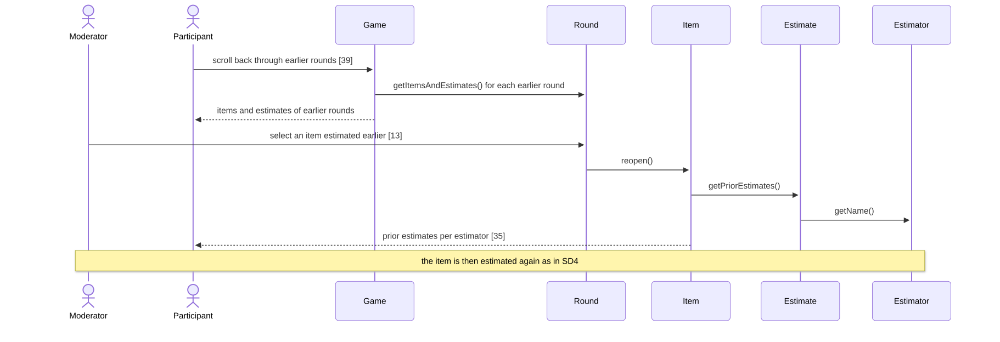](planningpoker/sd6_look_back.svg)

User stories covered

| # | User story |
|---|---|
| 13 | As a moderator, I want to estimate a item we estimated earlier in the round again, so that we can give a new estimate if we feel different about the item after estimating other related items. |
| 35 | As a participant, I want to be able to see each estimator's prior estimates for the item being estimated, so that I can see how his or her opinion has changed so I can ask questions. |
| 39 | As a participant, I want to scroll back through the items and estimates from prior rounds, so that I can use this information when I estimate the item of the current round. |

### SD7 · Manage previous games

The moderator finds a previous game, views its transcript, can export it as HTML or CSV, and can delete the game with its items and estimates.

[Mermaid source](../../4_gold_standard_sequence_diagrams/planningpoker/sd7_previous_games.mmd) · [SVG image](planningpoker/sd7_previous_games.svg)

[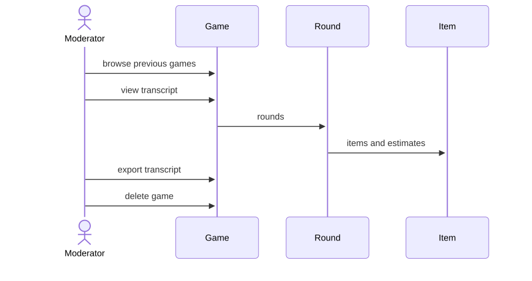](planningpoker/sd7_previous_games.svg)

User stories covered

| # | User story |
|---|---|
| 16 | As a moderator, I want to browse through previous games, so that I can find the previous game I’m looking for. |
| 17 | As a moderator, I want to view a transcript of a game, so that I can see the items and estimates. |
| 18 | As a moderator, I want to export a transcript of a game as a HTML file, so that I can save the items and estimates locally. |
| 19 | As a moderator, I want to export a transcript of a game as a CSV file, so that I can further process the items and estimates. |
| 20 | As a moderator, I want to delete a game, so that items and estimates for this game are no longer stored. |

## Ticket

7 diagrams, 73 messages, 51 of 54 user stories covered (not covered: 18, 27, 40). [User stories](../../1_user_stories/ticket.txt) · [Domain model](../ticket.svg)

### SD1 · Manage profile and preferences

A user saves personal and payment details, states preferred genres and event types in a survey, and later edits preferences and personal information or changes the password.

[Mermaid source](../../4_gold_standard_sequence_diagrams/ticket/sd1_profile.mmd) · [SVG image](ticket/sd1_profile.svg)

[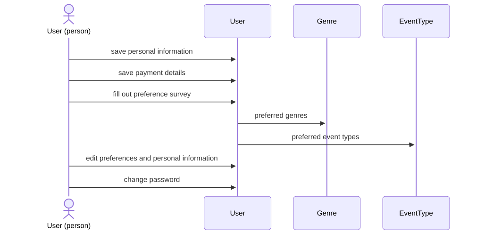](ticket/sd1_profile.svg)

User stories covered

| # | User story |
|---|---|
| 1 | As a user, I want to save my personal information (i.e., name, date of birth, email, address, and preferences) so that I don't have to repeat this process with every ticket purchase. |
| 2 | As a user, I want to save my payment details so that I don't have to fill these details in every time. |
| 3 | As a user, I want to fill out a short survey about my preferences in (music) genre and event types so that I can receive personalized content. |
| 5 | As a user, I want to see and edit my preferences so that my information does not become outdated. |
| 6 | As a user, I want to be able to change my password so that I can keep my account information safe. |
| 7 | As a user, I want to be able to edit my personal information (e.g., address) so that I can update it when needed. |

### SD2 · Discover events on the homepage

A visitor sees popular upcoming events and a calendar view; a logged-in user also gets events recommended from their preferences; clicking an event opens its page.

[Mermaid source](../../4_gold_standard_sequence_diagrams/ticket/sd2_homepage.mmd) · [SVG image](ticket/sd2_homepage.svg)

[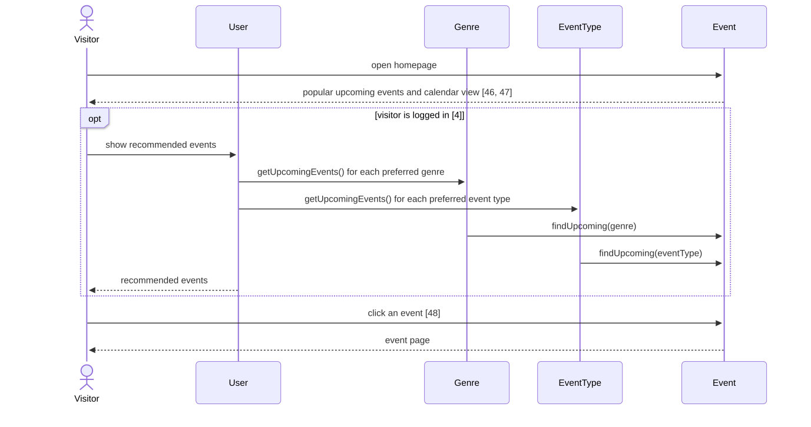](ticket/sd2_homepage.svg)

User stories covered

| # | User story |
|---|---|
| 4 | As a user, I want to see personalized content (e.g., recommended events) based on my user profile to quickly see events I am interested in. |
| 46 | As a visitor, I want to see upcoming events in a calendar-type view so that I can compare it to my own planner. |
| 47 | As a visitor, I want to see popular, upcoming events so that I can stay updated about interesting events. |
| 48 | As a visitor, I want to click on an event shown on the homepage and be directed to the event page, so that I don't have to search for it. |

### SD3 · Search for events

A visitor searches for an event by name, narrows the results by venue, genre and price, sorts them by date and opens one.

[Mermaid source](../../4_gold_standard_sequence_diagrams/ticket/sd3_search.mmd) · [SVG image](ticket/sd3_search.svg)

[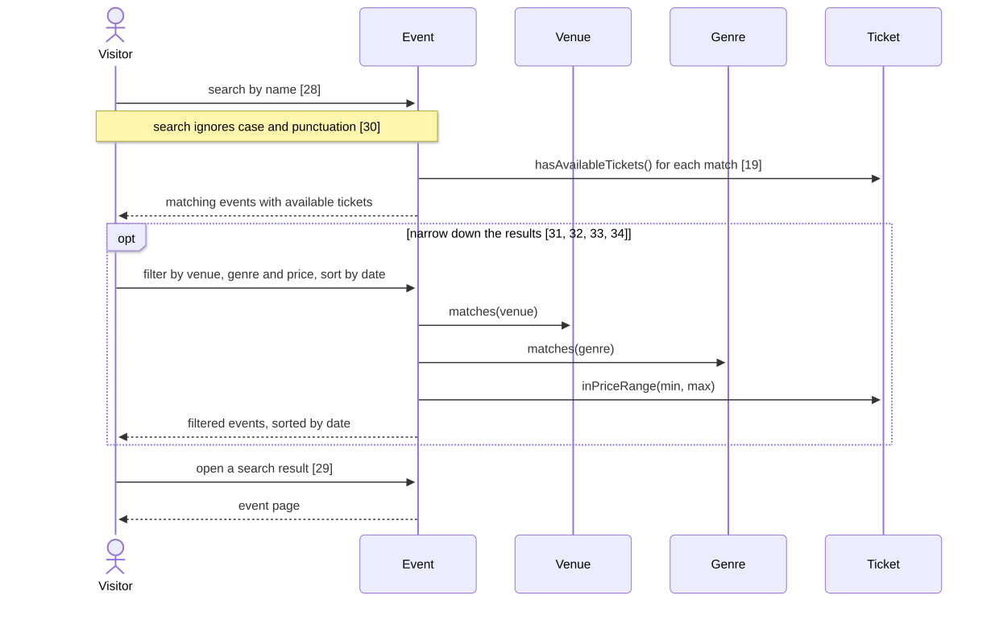](ticket/sd3_search.svg)

User stories covered

| # | User story |
|---|---|
| 19 | As a visitor, I want to see events with available tickets so that I can buy the tickets. |
| 28 | As a visitor, I want to get a list of events as search results, so that I can select the desired event. |
| 29 | As a visitor, I want to be able to land on the event page when clicking on a search result so that I can visit the page I want. |
| 30 | As a visitor, I want to have the search engine non-case sensitive and punctuation sensitive so that I can still find the desired event when I misspell the name. |
| 31 | As a visitor, I want to be able to sort my search results by date so that I can see which events are up first. |
| 32 | As a visitor, I want to be able to filter my search by price so that I can only see tickets within my price range. |
| 33 | As a visitor, I want to be able to filter my search results by venue, so that I can easily find the event I want to go to. |
| 34 | As a visitor, I want to be able to filter a list of events by genre, so that I don't have to see events I'm not interested in. |

### SD4 · Event page and favorites

An artist maintains a description and links that appear on the event page; a visitor reads the event page; a user favorites the event or artist and finds them in the profile.

[Mermaid source](../../4_gold_standard_sequence_diagrams/ticket/sd4_event_page.mmd) · [SVG image](ticket/sd4_event_page.svg)

[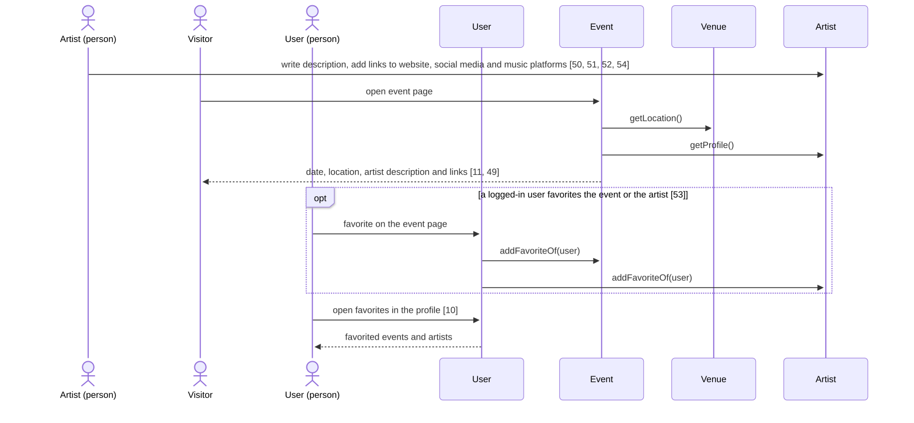](ticket/sd4_event_page.svg)

User stories covered

| # | User story |
|---|---|
| 10 | As a user, I want to find my list of favorited artists and events under my profile, so that I can easily find them back. |
| 11 | As a visitor, I want to read about the event (e.g., location, date, and artist information), so that I can decide whether to buy a ticket. |
| 49 | As an artist, I want to find information about my events on the designated event page so that visitors can read about my event and consider buying tickets. |
| 50 | As an artist, I want to have a link to my website on the event page so that fans can find out more about me. |
| 51 | As an artist, I want to have a link to my social media on the event page, so that fans can follow me for regular updates. |
| 52 | As an artist, I want to have a description of myself and my upcoming event (or tour) to be shown on my event page so that visitors can inform themselves about my show. |
| 53 | As a user, I want to favorite events or artists on the related event page, so that I can easily find it back. |
| 54 | As an artist, I want to have a link to music platforms (e.g., YouTube, Spotify, Apple Music), so that visitors buying tickets for my show can stream my music. |

### SD5 · Buy tickets

From the event page a visitor picks ticket types and seats on the venue map, puts several tickets in the cart, checks out as a user or as a guest, and pays.

[Mermaid source](../../4_gold_standard_sequence_diagrams/ticket/sd5_buy_tickets.mmd) · [SVG image](ticket/sd5_buy_tickets.svg)

[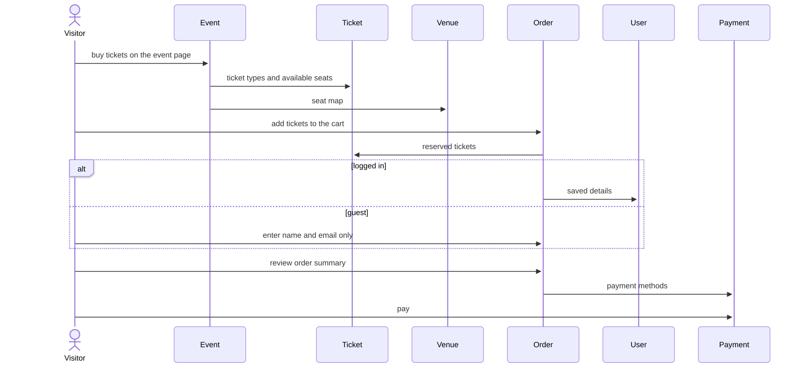](ticket/sd5_buy_tickets.svg)

User stories covered

| # | User story |
|---|---|
| 12 | As a visitor, I want to be able to buy tickets directly from the event page, so that the purchasing process is shortened. |
| 14 | As a (single-time) visitor, I want to buy a ticket as a guest, so that the overall purchase progress is shorter. |
| 15 | As a guest (i.e., single-time user), I want to only fill in my name and email when buying a ticket so that the process is faster than creating an account. |
| 16 | As a guest, I want to not fill in all my information to buy a ticket, so that I can avoid unnecessarily sharing my personal data. |
| 17 | As a guest, I can use the platform the same way as users looking to buy a ticket, so that I am not forced into registering. |
| 20 | As a visitor, I want to be able to buy multiple tickets for one event in one purchase so that I can buy tickets for me and whomever I go with. |
| 21 | As a visitor, I want to see available seats at the event, so that I can decide which one to buy. |
| 22 | As a visitor, I want to see the available seats in a map of the venue so that I can pick the right seating place for during the event. |
| 23 | As a visitor, I want to see the types of tickets (e.g., normal, premium, gold tickets) once I select the event, so that I can choose which type I want to buy. |
| 24 | As a visitor, I want to add tickets to the shopping cart, so that I can buy tickets. |
| 25 | As a visitor, I want to see my order summary, so that I can make sure that I buy the correct ticket(s). |
| 26 | As a visitor, I want to see a list of payment methods. so that I can pay for my tickets. |

### SD6 · Resell a ticket

A reseller saves an IBAN and uploads a digital ticket from the event page; the platform validates it and the minimum price; once a buyer purchases it, the reseller is paid minus a 3% fee.

[Mermaid source](../../4_gold_standard_sequence_diagrams/ticket/sd6_resell_ticket.mmd) · [SVG image](ticket/sd6_resell_ticket.svg)

[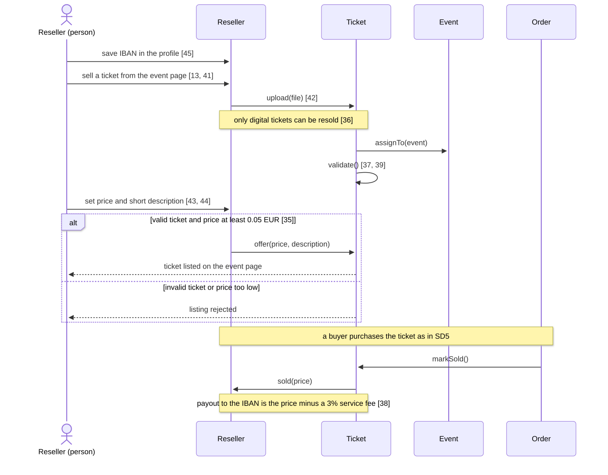](ticket/sd6_resell_ticket.svg)

User stories covered

| # | User story |
|---|---|
| 13 | As a reseller, I want to be able to sell my tickets directly from the event page, so that the reselling process is shortened. |
| 35 | As a company, I want to have the minimum price for reselling a ticket at 5 cents so that I can receive a service fee. |
| 36 | As a company, I want to have resellers sell only digital tickets, so that the tickets can be validated automatically. |
| 37 | As a company, I want to validate tickets, so that I can ensure visitors a trustworthy platform. |
| 38 | As a company, I want to deduct a service fee of 3% from the total price set by the reseller so that the reselling platform is a financially beneficial addition to the business. |
| 39 | As a company, I want to avoid fraudulent behavior on the reselling platform, so that visitors gain trust in the platform. |
| 41 | As a reseller, I want to be able to resell tickets directly from the event page so that the reselling process is shortened. |
| 42 | As a reseller, I can upload my digital ticket from my local device, so that I can offer it to other users. |
| 43 | As a reseller, I can set any price above 5 cents for the ticket I'm selling. |
| 44 | As a reseller, I can add a short description of the event so that the other (buying) users know what type of ticket, and for which event, I'm selling. |
| 45 | As a reseller, I want to save my bank account (IBAN number) in my user profile, so that I can receive the money for the tickets directly to my bank account. |

### SD7 · View orders and upcoming events

A user looks up previous ticket orders with their tickets and the upcoming events they hold tickets for.

[Mermaid source](../../4_gold_standard_sequence_diagrams/ticket/sd7_orders.mmd) · [SVG image](ticket/sd7_orders.svg)

[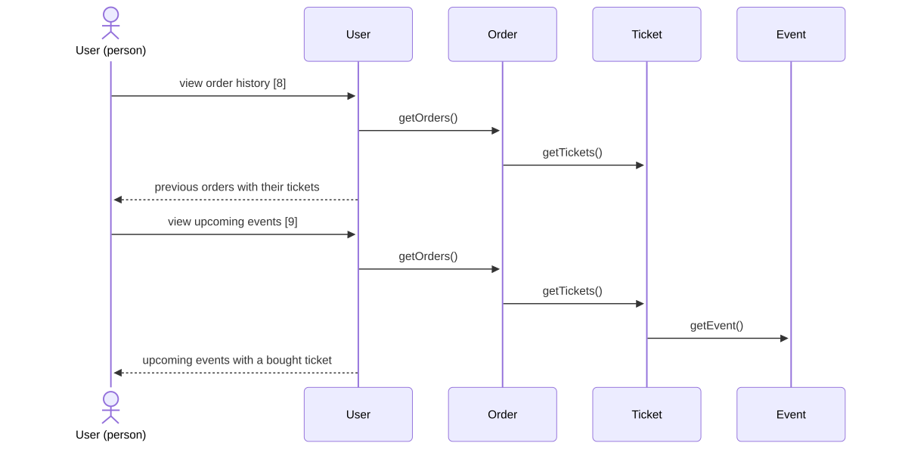](ticket/sd7_orders.svg)

User stories covered

| # | User story |
|---|---|
| 8 | As a user, I want to see a history of previous ticket orders, so that I can easily retrieve tickets and additional information when needed. |
| 9 | As a user, I want to see an overview of upcoming events for which I bought a ticket, so that I can easily find this information when needed. |

